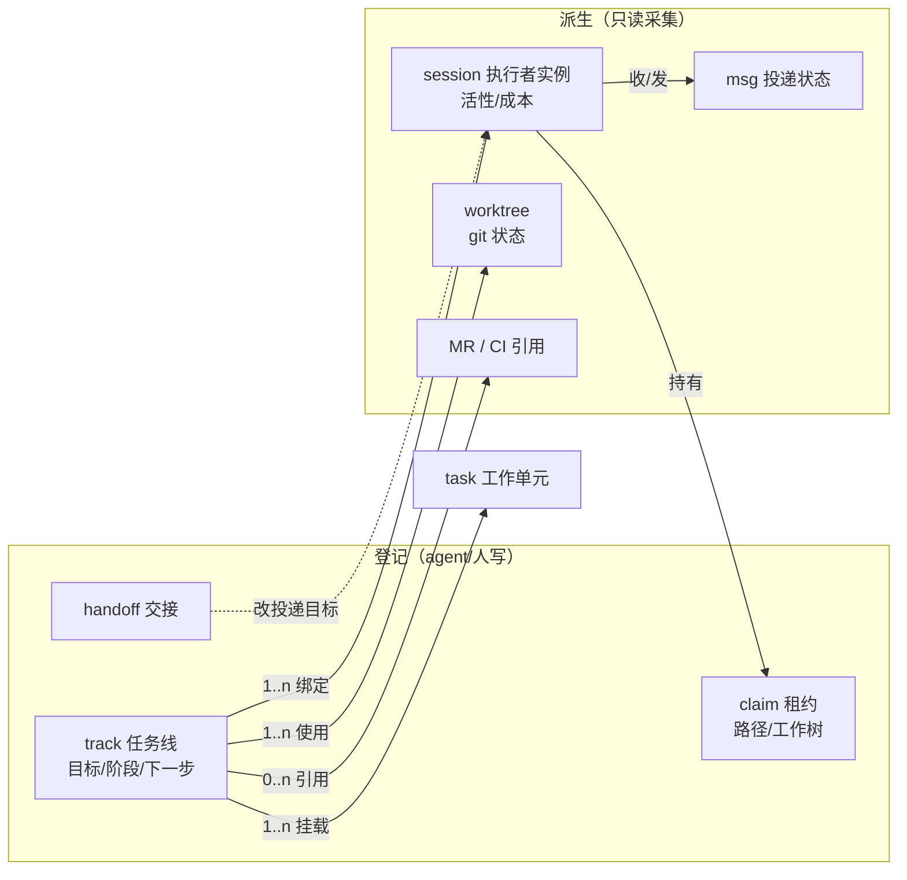
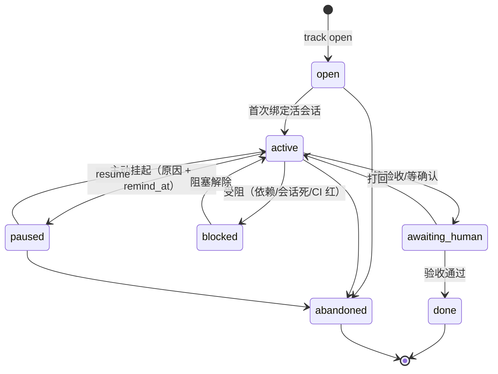
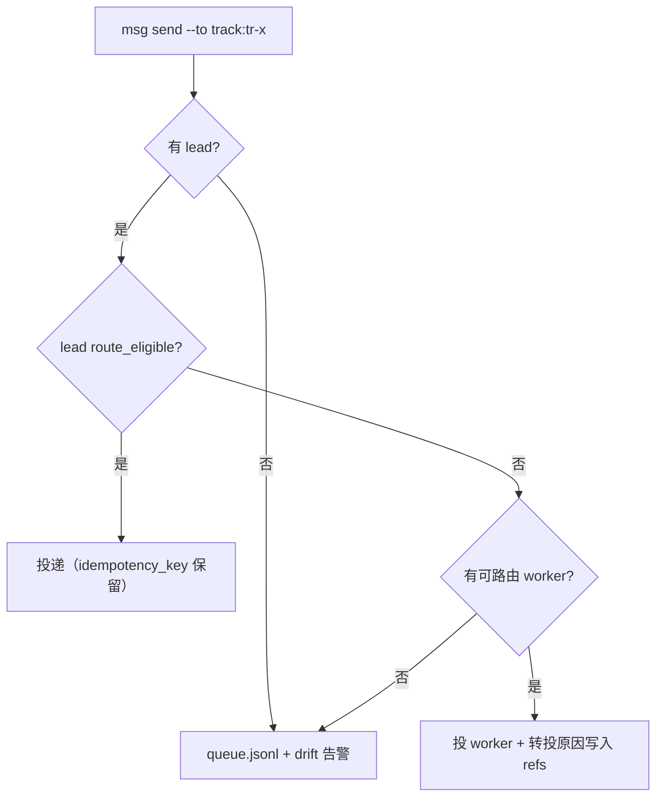

# 任务工作台（workbench）：长任务跨会话管理

> 状态：**设计 v2 已评审 · M0–M4 已实现并完成本机验收**（待 MR；`github.com` 恢复后推送）｜2026-11-18
> v2 变化：团队评审（redteam / planner / verifier / 需求覆盖）后修正 5 个致命假设，见 §0.1
> 关联：`docs/host-control-surface.md`、`docs/design/graph-prio-dag.md`、`docs/msg-collab-m1-design.md`、
> `core/knowledge/workflows/worktree-forms.md`（R20）

---

## 0. 决策与评审

### 0.1 六个已拍板决策

| # | 决策轴 | 结论 |
|---|---|---|
| 1 | 事实源 | **派生 + 显式登记**。派生值赢，台账只记意图，差异落 `drift.jsonl` |
| 2 | 拓扑 | **单机起步，v1 模型带 `host`**；跨机只读拉取，不做双向同步 |
| 3 | 活性 | **派生三态** `alive/suspect/dead` + 心跳佐证；`dead` 与 `resumable` 正交 |
| 4 | 粒度 | **两层**：`track`（任务线）+ 现有 `dia task`（工作单元），状态机隔离 |
| 5 | 范围 | **全做**：模型/采集/看板/认领/路由/统计都进 v1；实现按 M0–M4 分期 |
| 6 | 统计 | **全派生**；不做人评分、不做人排名 |
| 7 | 数据生命周期 | **白名单制**：只有 `config.json` 白名单里的文件是资产；其余随时可清；每个白名单文件有硬上限与溢出策略（§3.6） |

### 0.2 评审打穿的 5 个致命假设（已修正）

| # | 原设计假设 | 实测事实 | v2 修正 |
|---|---|---|---|
| B1 | opencode 读 `session`/`message` | `session` 是**遗留表**：34 行，最新 `2026-10-02`；真实数据在 `session_v2` 1137 行（最新今天）+ `session_message` 110811 行 | §4.1：**v2 only**；旧表只做一次性迁移（有损），不保留永久回退 |
| B2 | 采集 2s 内完成 | dsh 415 个 zstd 同步解压 5.2s；project-a 44 棵 wt 逐棵 `git status` 16.3s | §4.5 / §9.1：**快照读与采集分离**（`dia wb` 只读快照，`dia wb refresh` 采集）；dsh 走子进程 + 水位；wt 只查已认领 |
| B3 | 消息可存 `track:` 地址并事后改投 | `SESSION_RE` 拒绝冒号；消息落盘路径 = `inbox/<session_id>/` | §7.2：新增 additive 字段 `to_addr`/`to_resolved`；**v1 不改投已落盘消息**，未解析的进 `queue.jsonl` |
| B4 | 15min/12h 阈值够用 | 宿主有 `time_suspended/time_idle/idle_outcome/time_archived`；等 CI 40 分钟的会话会被判 suspect 而不可路由 | §5.2：**投递就绪**与**路由可用**拆成两个判定；claim/心跳可把 suspect 提升为可路由 |
| B5 | 判据可执行 | token 两条路径差 91/8/384；「杀会话变 orphan」要等 12h；当前 0 claim 会秒过 | §11：判据全部改为 **fixture + `--now` 注入 + 容差** |

### 0.3 其余采纳项

- **多仓 track 一等公民**（§3.1 / §9.2）；`repo` 统一为完整 group 路径（`org/group/project-a`），
  修掉 `claims.scopeFor()` 只取末两段导致 track↔claim 永不相等的问题。
- **claim 键加工作树身份**（§6.2）：`repo_slug::toplevel_hash::relpath`，否则跨 wt 同名文件误冲突。
- **`dia wt` 只做薄封装**（§6.4）：不直读 JSONL、参数白名单、未知 `-*` 报错；`list` 补 flag 解析与 `--json`。
- **推送式「未来关注」**（§9.3）：`next` / `waiting_on` / `remind_at` + `dia wb due` + `dia wb brief`（开工自检）。
- **MR/CI 竞争**（§6.5）：同仓多 active track 的 `contending` 建议（只读，不自动合并）。
- **组播动态成员**（§7.4）：track 参与者即隐式组；另加显式 `dia collab group`。
- **入口改名 `dia wb`**（§9.1）：避免与既有 `dia collab board` 同名不同义。

---

## 1. 为什么做

### 1.1 现状证据（本机实测，2026-11-18）

| 现象 | 证据 |
|---|---|
| 任务台账无会话/目录/资源维度 | `~/.dia/tasks/ledger.jsonl` 141 条；union 字段 = `ts/event/id/status/evidence/title/role/judge/deps/touches/prio/owner`，**无 session/cwd/wt** |
| 消息寻址靠手写 session id | `dia agents list` = `(none)` |
| 工作树大量无人认领 | project-a `dia wt list` 44 条（含 main），其中 **4 棵 prunable**；`dia claims` 活跃 **0** 条（4 行 = claim 2 + release 2） |
| 会话身份与投递通道脱节 | `~/.dia/collab/sessions/*.json` 35 个，**0 个有 pane**；`tmux ls` = no server |
| 会话状态 ≠ 任务状态 | 35 个 collab 会话中，≤15min 有活动 **0** 个、≤12h **1** 个（中位 190h） |
| 数据源用错 | `session` 34 行停在 2026-10-02；`session_v2` 1137 行、`session_message` 110811 行 |
| 成本不可得 | `session_v2.cost` 1137 条中仅 **2 条 > 0**（合计 0.79 USD）；`pricing.ts` 只覆盖 3 个型号，实际 `example/*` 覆盖 **0** |
| 同一条线被切碎 | 灰度开通被三次 redteam 回灌成 3 条独立 task（`t-6d1bb07d` / `t-08912881` / `t-a6638c20`） |

### 1.2 目标 / 非目标

**目标**

1. 回答：**哪些长任务在跑、卡在哪、下一步是什么、谁在带、资源在哪**。
2. 会话可死、任务不死：消息按 `track` 寻址，死会话不再吞消息。
3. 工作树/文件认领有租约，共享必须显式，主 checkout 污染可见。
4. 成本与效率归因到 track / session / 天；团队模式可对照（带样本数）。
5. **推送式提醒**：不敲命令也会在合适的时候被告知「这条线还欠着」。
6. 无守护进程：快照按需刷新，`dia job` 可选定时。

**非目标**：不做通用编排引擎；不自动合并/发布；不 patch 宿主、不写宿主库；不做跨机双向同步、不做 SaaS、不做人排名。

---

## 2. 概念模型



### 2.1 三个实体，各管一段生命周期

| 实体 | 生命周期 | 事实源 | 谁写 |
|---|---|---|---|
| **track** | 周～月；跨会话/跨天/可挂起 | `~/.dia/workbench/tracks.jsonl`（append-only） | agent 显式登记 |
| **session** | 分钟～天；会死、可恢复、可多实例 | 宿主库 + `collab/sessions` + beat | 宿主产生，dia 只读派生 |
| **task** | 小时～天；一次可判定的工作单元 | 现有 `tasks/ledger.jsonl` | 人/agent/team（**不变**） |

> `track` ≠ `dia msg` 的 `thread`（消息串）≠ `dia team` 的 `task`（执行状态机）。
> track 表达的是**意图**：还欠不欠、卡在谁、下一步做什么。

### 2.2 track 状态机



- `blocked` **只由派生推荐**，落账仍要人/agent 一步（避免看板自编状态）。
- `stage` 自由文本；`status` 只表达「能否推进」。

---

## 3. 数据布局与数据模型

```
~/.dia/workbench/
  tracks.jsonl        # ★ 资产（白名单）意图，append-only，fold 容错
  config.json         # ★ 资产（白名单本身）
  queue.jsonl         # ★ 资产（未投递消息）
  beats.jsonl         # 可清（TTL 720h / 5 万行）
  drift.jsonl         # 可清（TTL 168h / 5000 行）
  derived/            # 可清（TTL 72h；整目录可删、可重建）
    snapshot.json     # board 的唯一读源（含 as_of）
    sessions/<id>.json
    worktrees.json
    metrics/<YYYY-MM-DD>.json
  .locks/             # 运行时锁（不属资产，随时可清）
```

> ★ = 白名单内、永不自动删除（但有硬上限）。其余一律视为可随时清除——
> 这是 §3.6 的强约束，不是建议。

**读写分离（B2 修正）**

- `dia wb` / `dia wb --json`：**只读** `derived/snapshot.json` + 廉价实时检查（git HEAD/分支），打印 `as_of` 与 `age`。
- `dia wb refresh [--depth fast|full]`：唯一采集入口。`fast` = opencode + registry + 已认领 wt；`full` = 追加 dsh + 全量 wt。
- `--watch`：每 N 秒在**后台子进程**触发一次 refresh，读路径不变（不会阻塞 TUI）。
- `dia job` 可挂 `dia wb refresh --depth full` 每 10 分钟一次（可选，不做默认）。

### 3.1 track 事件

```jsonc
{"ts":"2026-11-18T10:00:00.000Z","event":"open","id":"tr-3f9a1c2e",
 "title":"灰度开通服务","goal":"redteam 回灌收口并上线",
 "next":"补 reply 幂等单测","waiting_on":{"kind":"human","ref":"maintainer","note":"等验收"},
 "repo":["org/group/project-a","org/group/yan-agent"],
 "prio":"P1","owner":"maintainer","stage":"dev","remind_at":"2026-11-19T09:00:00+08:00",
 "refs":[{"kind":"mr","value":"!1975","repo":"org/group/project-a"}]}
{"ts":"…","event":"bind","id":"tr-3f9a1c2e","session":"ses_abc","role":"lead","host":"opencode"}
{"ts":"…","event":"stage","id":"tr-3f9a1c2e","status":"blocked","reason":"lead dead 12h","next":"改派 lead"}
{"ts":"…","event":"handoff","id":"tr-3f9a1c2e","from":"ses_abc","to":"ses_def","reason":"终端关闭"}
{"ts":"…","event":"attach_task","id":"tr-3f9a1c2e","task":"t-6d1bb07d"}
{"ts":"…","event":"close","id":"tr-3f9a1c2e","reason":"accepted","evidence":"pipeline green + 验收截图"}
```

| 字段 | 说明 |
|---|---|
| `id` | `tr-` + `sha1(title+Date.now()).slice(0,8)`；同 `title+repo` 已有未关闭 track → `E_TRACK_DUP(43)` 并返回既有 id |
| `status` | `open/active/paused/blocked/awaiting_human/done/abandoned` |
| `next` | **一句话下一步**（接手者第一眼要看的） |
| `waiting_on` | `{kind: human\|session\|mr\|dep\|date, ref, note}` |
| `remind_at` | 「未来关注」的触发时刻（ISO 带时区） |
| `repo[]` | **完整 group 路径** `group/sub/repo`，多仓一等公民 |
| `sessions[]` | `{session_id, role, host, bound_at, unbound_at}` |
| `tasks[]` | `t-xxx` 引用（状态实时读 ledger） |
| `derived` | 只读注入：`lead_liveness`、`worktrees[]`、`metrics`、`drift[]`、`contending[]` |

### 3.2 会话派生记录

```jsonc
{"schema_v":1,"session_id":"ses_abc","host":"opencode","host_scope":"mac",
 "cwd":"~/repos/project-a-worktree--store-groups",
 "repo":"org/group/project-a","branch":"feat/store-groups",
 "tracks":["tr-3f9a1c2e"],
 "first_seen":"…","last_activity":"…","last_heartbeat":null,
 "liveness":"suspect","liveness_evidence":[
   {"source":"host","ts":"…","weight":"primary","detail":"last assistant message 41m"},
   {"source":"claim","ts":"…","weight":"support","detail":"holds cl-…"},
   {"source":"pane","ts":null,"weight":"none","detail":"no pane binding"}],
 "resumable":true,"delivery_ready":false,"route_eligible":true,
 "turns":42,"tools":{"bash":96,"edit":18},"tool_errors":3,
 "tokens":{"input":120000,"output":8000,"cache_read":90000,"cache_write":0},
 "cost_usd":null,"priced":false,"models":["example/deepseek-v4.1-flash"],
 "title":"灰度开通收口","raw_ref":"opencode:ses_abc"}
```

### 3.3 工作树视图（多仓顶层）

```jsonc
{"schema_v":1,"as_of":"…",
 "repos":[{"repo":"org/group/project-a","repo_path":"~/repos/project-a",
   "worktrees":[{"path":"…/project-a-worktree--store-groups","branch":"feat/store-groups","head":"c408ce3",
     "dirty":4,"dirty_state":"checked","prunable":false,"merged_to_main":false,
     "claim":{"id":"cl-…","holder":"ses_abc","track":"tr-3f9a1c2e","lease":"exclusive","expires_at":"…"},
     "flags":["claimed"]}]}]}
```

- `dirty_state`: `checked` / `not_checked`（未认领且非 full 时**不跑 status**，不写 0 假装干净）。
- `flags`: `claimed / orphan / shared / main-dirty / merged-prunable / detached / behind / not_checked`。

---

### 3.4 一次性迁移（早期策略，允许有损）

dia 仍是早期项目：**不为旧结构长期兼容**。新增一条命令，跑一次就完事：

```
dia wb migrate [--dry-run] [--force]
```

| 对象 | 动作 | 有损说明 |
|---|---|---|
| opencode 遗留 `session`/`message` | 导出到 `derived/legacy-import.json`（id/cwd/时间/标题/token 汇总） | 丢弃消息正文与工具明细 |
| 旧 claim（无 `toplevel_hash`） | 能重算的重算；算不出的丢弃 | 当前活跃 0 条，实际无损失 |
| `derived/` 旧快照 | 整目录删除重建 | 无（可重建） |
| `beats.jsonl` 旧行 | 保留 30 天，其余截断 | 仅历史统计 |
| track/queue/drift | 新文件，不存在迁移 | — |

- 迁移只写 `~/.dia/workbench/`，**不碰宿主库与现有 task/msg 数据**。
- `--dry-run` 打印将丢弃的条数；无 `--force` 时遇到不可逆项要求确认。
- 不提供 rollback：迁移前自动备份到 `~/.dia/backups/workbench-<ts>.tgz`（仅当目录存在数据）。
- 迁移会写入默认 `config.json`（把白名单显式落盘，便于人审阅与调整）。

### 3.6 数据白名单与溢出收敛（强约束）

**原则**：只有白名单里的文件是资产；不在名单里的**随时可清**；每个白名单文件必须有**硬上限**与**溢出策略**。
不允许「先写再说、以后清理」——写之前就要过校验。

#### 3.6.1 配置即白名单（`~/.dia/workbench/config.json`）

```jsonc
{"schema_v":1,
 "durable":[
   {"path":"tracks.jsonl","why":"track 意图事实源","max_bytes":8388608,"max_lines":50000,"on_overflow":"compact"},
   {"path":"queue.jsonl","why":"未投递消息","max_bytes":2097152,"max_lines":2000,"on_overflow":"fail"},
   {"path":"config.json","why":"白名单自身","max_bytes":65536,"max_lines":2000,"on_overflow":"fail"}],
 "ephemeral":[
   {"path":"derived/**","ttl_h":72},
   {"path":"beats.jsonl","ttl_h":720,"max_bytes":2097152,"max_lines":50000,"on_overflow":"rotate"},
   {"path":"drift.jsonl","ttl_h":168,"max_bytes":2097152,"max_lines":5000,"on_overflow":"rotate"}],
 "quota":{"root_max_bytes":104857600,"warn_ratio":0.8}}
```

| 文件 | 类别 | 上限 | 溢出策略 | 理由 |
|---|---|---|---|---|
| `tracks.jsonl` | durable | 8MB / 5 万行 | `compact`（折叠成每 track 一条 `open` + 活跃 bind，历史事件丢弃） | 意图不能无限长；有损可接受 |
| `queue.jsonl` | durable | 2MB / 2000 行 | `fail`（拒绝新入队 + 告警） | 丢队列＝丢消息，宁可停住 |
| `config.json` | durable | 64KB | `fail` | 白名单自身不能被写坏 |
| `derived/**` | ephemeral | TTL 72h | `purge` | 可重建 |
| `beats.jsonl` | ephemeral | 720h / 5 万行 | `rotate` | 仅佐证 |
| `drift.jsonl` | ephemeral | 168h / 5000 行 | `rotate` | 告警历史 |

- 配置缺失/损坏/版本不符 → **回落内置同一份默认值**，保证 GC 永远不会误删资产。
- 白名单之外的写：`E_WB_WHITELIST`（写入层直接拒绝，不产生文件）。
- 路径校验：必须是相对路径、禁止 `..` 与绝对路径；删除时 `lstat` + 不跟随符号链接。

#### 3.6.2 溢出策略（三选一，必须显式）

| 策略 | 行为 | 适用 |
|---|---|---|
| `fail` | 拒绝本次写入并告警（`E_WB_OVERFLOW`），提示先跑 `dia wb gc --apply` | 不可丢的数据（queue、config） |
| `rotate` | 保留 TTL 内 + 最后 N 行，原子重写 | 追加日志（beats/drift） |
| `compact` | 折叠成最小状态快照后重写（有损） | 意图账本（tracks） |

#### 3.6.3 收敛命令

```
dia wb gc [--apply] [--json] [--now ISO]
```

- **默认 dry-run**：只报告 `removed / rotated / skipped / quota`，不动磁盘。
- `--apply` 才真删；删除范围**严格限定在 workbench 根内**。
- 不在白名单的文件 → `not-whitelisted` 删除；`ephemeral` 超 TTL → 删除；超行数 → rotate。
- 符号链接：**不跟随、不删除**，进 `skipped`（防误删到根外）。
- 配额：根总量 `root_max_bytes`（默认 100MB）；`warn_ratio` 80% 告警；超限 `--apply` 退出码 1。
- `dia wb refresh` 末尾只对 **ephemeral** 自动 gc（durable 永不自动删），并且 best-effort（失败只告警）。

#### 3.6.4 与迁移的关系

`dia wb migrate`（§3.4）写入默认 `config.json`；之后所有写入都走白名单校验。
「早期、允许有损」在这里体现为：**白名单可以很短，其余一律可清**——不需要为任何非资产文件的兼容性买单。

---

## 4. 采集器（只读、可降级、可中断）

### 4.1 opencode（B1 修正 + 早期策略）

**v2 only**。dia 仍处早期，不为遗留表背包袱：

1. 探测 `session_v2` + `session_message`；存在即用。
2. 读取：`session_v2`（id/title/directory/parent_id/time_created/time_updated/time_suspended/time_idle/idle_outcome/time_archived）
   + token 汇总列；`session_message` 按 `type IN ('assistant','user')` 聚合 turns/tool 调用
   （**排除 `idle`/`synthetic`**，单独计数）。
3. 只有 legacy 表（`session`/`message`）时：**不长期兼容**——`dia wb migrate` 一次性把能读的会话搬进
   `derived/legacy-import.json`（有损：只留 id/cwd/时间/标题），之后看板只用 v2；无 v2 且未迁移 → `sources.opencode:"unsupported"`
   并在 `ALERTS` 明确写「需升级宿主 / 跑迁移」。
4. 只读打开；WAL 下失败重试一次；**绝不写宿主库**（判据用前后 sha256）。

> `session_v2` 自带的 token 汇总与 `session_message` 逐条求和存在差值（实测 in 91 / out 8 / cache 384）。
> **口径写死**：会话级总量取 `session_v2` 汇总列；消息级明细取 `session_message`；两者不追求相等，
> `metrics` 输出 `totals_source:"session_v2"` 与 `detail_source:"session_message"`。

### 4.2 dsh（B2 修正）

- 目录 `~/.dsh/sessions/*/*/session.v4.jsonl.zstd`（本机 415 个，解压后约 454MB）。
- **不在主进程同步解压**：`refresh` 派生子进程（`node --input-type=module` 内联脚本或 `src/workbench/dsh-worker.ts`），
  主进程 800ms 等首包、5s 总超时；超时保留上次快照并标 `dsh:"timeout"`。
- 水位：`{file → mtime,size}` 存 `derived/state.dsh.json`，只解压变更文件。
- 取字段：`session` 头（id/cwd/createdAt）、`assistant/message.data.usage`、`turn/start|turn/end`。
- 单文件损坏跳过并计数；非 v4 跳过。

### 4.3 worktrees（B2 修正）

- 仓来源：track `repo[]` + `collab` 会话 cwd 命中的 git 根（去重）。
- `git worktree list --porcelain`（便宜，全量）。
- `git status --porcelain` **只对** claim 持有/ track 绑定的 wt 执行；其余 `dirty_state:"not_checked"`。
- `--full` 才全量 status；`--untracked-files=no`；按 `.git/index` mtime 缓存。
- 本机实测：44 棵全量 16.3s，仅已认领（预计 ≤5 棵）< 2s。

### 4.4 其他

| 采集器 | 来源 | 失败策略 |
|---|---|---|
| `sessions.registry` | `~/.dia/collab/sessions/*.json` | 脏文件跳过 |
| `git` | `rev-parse` / `merge-base` / `log -1` | 单仓失败只影响该仓 |
| `mrs` | 台账 `refs` + 可选 `glab api` | **默认不联网**；`--refresh mrs` 才拉 |
| `msg` | `~/.dia/collab/inbox/*` + `queue.jsonl` | 计数与最老年龄 |

### 4.5 契约

- 每个采集器带 `timeout_ms`、`status: ok|degraded|timeout|unavailable|skipped`、`detail`。
- `snapshot.json` 必带：`as_of`、`duration_ms`、`sources{}`、`schema:"v2|legacy"`。
- `--depth fast`（默认）不跑 dsh 与全量 wt；`--depth full` 才跑。
- **绝不用 `session.directory` 推断「会话在用哪棵 worktree」**：实测 204 个会话的 directory 是主 checkout，
  实际改动发生在 worktree（bash `cd`）。归属只认 `claim` / `track.bind`（可选手工 `--cwd` 覆盖）。

---

## 5. 活性判定（B4 修正）

### 5.1 三态 + 两个派生布尔

| 概念 | 判定 | 用途 |
|---|---|---|
| `alive` | 最近活动或心跳 ≤ **15 min**，且宿主未 suspended | 即时投递 |
| `suspect` | 15 min < 活动 ≤ **12 h**，且宿主未 suspended/archived | 需佐证才可路由 |
| `dead` | > 12 h 无活动，或宿主 `time_archived` / `time_suspended` | 不作投递目标（但可 `resumable`） |
| `delivery_ready` | `alive` | `dia msg` 直投 |
| `route_eligible` | `alive` **或**（`suspect` 且持有有效 claim / 15min 内心跳） | track 路由的候选集 |
| `resumable` | 宿主仍保留会话记录 | 支持「dead 但可恢复」 |

> `route_eligible` 就是为了解决「等 CI 40 分钟」：时间上已是 suspect，但持有 claim 说明 agent 还在，
> 路由仍可投；没有 claim/心跳的 suspect 不自动接消息（防投给已经关掉的窗口）。

### 5.2 证据优先级

1. **宿主原生状态**（`time_suspended` / `time_idle` / `idle_outcome` / `time_archived`）——优先于时间阈值
2. 宿主会话库的 `time_updated` / 最后消息时间
3. `collab` 的 pane 绑定 + `pane_pid`（**当前 0/35 可用，tmux 无 server，作 `weight:none`**）
4. `beats.jsonl` 心跳（只加分）
5. 进程探测（只作弱否定证据；opencode daemon 常驻）

`liveness_evidence[]` 记录每条来源与权重；`dia wb --explain <id>` 原样打印。

### 5.3 阈值配置

```jsonc
{"schema_v":1,
 "liveness":{"alive_min":15,"suspect_h":12},
 "route":{"require_evidence_for_suspect":true},
 "lease":{"default_ttl_h":24,"auto_renew":false},
 "collect":{"dsh_timeout_ms":5000,"git_status_timeout_ms":1500}}
```

按 host 分档（`liveness.hosts.<host>.alive_min`）预留，v1 不分档。

---

## 6. 绑定、认领与工作树治理

### 6.1 track 绑定

- `dia wb track open "<title>" --repo R [--repo R2] --goal G [--next N] [--prio P1]`：自动绑当前会话为 `lead`。
- `dia wb track bind <tr> [--session S] [--role lead|worker|reviewer]`
- `dia wb track handoff <tr> --to <session> --reason R`：写交接 + 给旧会话发 `handoff`（不要求回复）。
- `dia wb track next <tr> --set "…" --waiting-on human:min`：维护「下一步」。
- **约束**：一个活跃 track 只能 1 个 lead；一个会话最多 1 个 lead 身份（可当多个 track 的 worker）。
  违反 → `E_TRACK_AMBIGUOUS(42)`，列候选，要求显式 handoff 或 `--force`。
- 会话死亡**不自动改绑**：只出 drift + `blocked` 建议，必须显式 handoff。

### 6.2 认领租约（additive）

```
dia claim <path>|--worktree <path> --track <tr> [--lease exclusive|shared] [--ttl 24h] [--reason R]
```

- **键改为 `repo_slug::toplevel_hash::relpath`**：`repo_slug` 用完整 group 路径（`org/group/project-a`），
  `toplevel_hash` 是 worktree 绝对路径的 8 位 hash。解决两个问题：
  ① `scopeFor()` 只取末两段导致 track 的 `org/group/project-a` 与 claim 的 `group/project-a` 永不相等；
  ② 同仓两棵 wt 的同名文件被误判为同一资源。
- **旧 claim 一次性清理**（dia 早期，允许有损）：`dia wb migrate` 重算可重算的键，算不出的丢弃并计数；
  当前活跃 claim = 0，实际无损失。不保留 `legacy:true` 分支。
- `exclusive`（默认）：同键第二持有者 → `E_CLAIM_LEASE(44)` 并打印持有者与剩余 TTL；
  共享必须 `--lease shared --reason "…"`，保持 shared 期间 `dia wb` 常驻标红。
- 回收：`dia claims --gc` 扩为「持有者 dead 且过期 → 释放，`released_reason=holder-dead`」。
- 原则不变：**advisory**，不拦直接改文件（拦不住也不假装拦得住）。

### 6.3 工作树治理

- `dia wt create <repo> <feature> --track <tr>`：创建后调 `dia claim` + 绑定（**wt 不直读 JSONL**）。
- `dia wt list --orphan [--json]`：`cmd_list` 需补 flag 解析（现状传 `--orphan` 会报「仓库不存在」）。
- `dia wt check --track <tr>`：脏/落后 main/主 checkout 污染/配额，**按仓分组**输出。
- `main-dirty` 统一为 per-worktree flag（谁被 status 命中谁标），不再按 track cwd 另算一套。
- 关闭 track 只出「可回收清单」，`dia wt clean` 仍人工确认（R25）。

### 6.4 `dia wt` 桥接约束（planner 风险）

- `packages/wt/bin/dia-wt` 是 bash；**不新增第二套判定**：orphan/shared/merged 只在 TS 侧算。
- wt 里所有新 flag 走**白名单 + 未知 `-*` 直接 die**（现状 `*) shift` 会静默吞参，用户以为已绑定）。
- 数据根分裂：`dia_wt_data_root()` 默认 `~/.yan-agent`，`diaHome()` 默认 `~/.dia`。
  → wt 一律通过 `dia` 子命令读写，缺 `dia` 时降级提示，不自行拼路径。
- `create` 成功额外打印 `track=<tr> claim=<cl-id>` 一行，作为绑定确认。

### 6.5 MR / CI 竞争（新增）

- 只读派生：同 `repo` 下多个 `active/awaiting_human` track 且都有 `refs[mr]` → 标 `contending`。
- 输出建议顺序（不改任何状态）：按 `prio → 最早 MR 创建时间 → 变更文件重叠度`。
- `refs` 的 `repo` 必填；跨仓 track 逐个仓列。
- 不代替 `yan-mr` 的合并队列；只提示「先合谁、可能撞哪些文件」。

---

## 7. 消息路由（B3 修正）

### 7.1 地址空间

| 地址 | 解析 |
|---|---|
| `session:<id>` | 精确会话（现有行为不变） |
| `track:<tr-id>` | lead（alive）→ lead（suspect 且 route_eligible）→ worker（alive，按绑定时间倒序）→ 未解析进 `queue.jsonl` |
| `track:<tr-id>/*` | 广播到该 track 所有 `route_eligible` 会话（**默认只允许 `notify` 类**） |

### 7.2 落盘与改投（关键修正）

- 消息对象 additive 增加：`to_addr`（原始地址，如 `track:tr-x`）、`to_resolved`（解析后的 session id）。
  `to` 仍写 session id，**老读者不受影响**。
- `resolveAddress()` 插在 msg CLI 顶层（现有 `/^ses_/` 判定之前），避免 `track:` 静默掉进 v1 agent 路径。
- **v1 不支持已落盘消息改投**（跨目录搬文件 + 改 to 会破坏不可变语义）。
  未解析/无可用目标 → 进 `queue.jsonl`，**不出现在任何 inbox**：
  ```jsonc
  {"id":"q-…","addr":"track:tr-x","kind":"question","subject":"…","body_file":"…",
   "refs":{},"reason":"no-route-eligible","created_at":"…","resolved_at":null}
  ```
- 出队时机：`handoff` / `bind` 后自动尝试一次；或 `dia msg retry --queue` 手动。
- 已 `delivered` 未 `acked` 的消息**永不自动重投**；N 小时无 ack → `escalated`（人工决定），防双执行。

### 7.3 路由失败语义



- 退出码：`40 E_ROUTE_UNRESOLVED`（进队列也算失败，便于脚本发现）；`41 E_ROUTE_MOVED`（旧会话收到已迁移地址）。

### 7.4 组播与成员

- **track 参与者就是隐式组**：bind/unbind 即增删成员，无需维护名单（解决「组播加组员」）。
- 显式组：`dia collab group add|remove|list`，存 `~/.dia/collab/groups.jsonl`（additive），
  `dia msg send --to group:<name>`。现有 collab 只有统计分组，没有成员组，这个是新增。
- 广播默认 `notify`；`kind=question/handoff` 需 `--fanout execute` 显式声明，
  防止 N 个会话同时执行「去改 X」（双提交/双 MR）。

### 7.5 与现有 `dia msg` 的关系

- 不改消息文件格式（只加字段）；投递仍走现有邮箱 + tmux/ACP（tmux 当前不可用，**不承诺唤醒**）。
- `dia msg inbox` 不变；`dia collab board` 增加按 track 聚合（只读）。

---

## 8. 统计与效率（全派生）

### 8.1 口径

| 指标 | 来源 | 口径 |
|---|---|---|
| tokens | `session_v2` 汇总列（会话级）；`session_message`（明细） | `totals_source`/`detail_source` 显式输出；排除 `idle`/`synthetic` 的 turn 计数 |
| 费用 | `session_v2.cost` **仅当 > 0**；否则 `pricing.ts` 换算 | 未知型号 → `cost_usd:null`、`priced:false`、`unpriced++`；**0 不等于免费** |
| 墙钟时长 | `first_activity → last_activity` | 含挂起，仅参考 |
| 活跃时长 | 相邻 turn ≤10min 的累加 | `estimated:true` |
| 轮次 | v2：`session_message.type='user'`；dsh：`turn/start` | — |
| 工具失败率 | v2：`session_message` 中 tool part 非 completed；dsh：`tool/result` 失败 | 只算执行失败 |
| 返工 | `dia team` 的 redteam/fix 轮次 | — |
| 阻塞时长 | track `blocked` 区间累加 | 需 stage 事件带 reason |
| 结果 | `tasks` 的 done/accepted ÷ attempted；judge 覆盖率 | 读 task ledger |

### 8.2 团队模式（改为可回答）

- `mode=team` **当且仅当**：有 `dia team run` 记录关联该 track，或角色集合 ⊇ {builder, verifier}。
  **不用「≥2 会话」判**（会把 solo+子会话误判成 team）。
- 对照：按 `goal_type`（`repo + 任务类别标签`，如 release/fix/feature）分组，比较
  「token/完成任务」「活跃时长/完成任务」「返工轮次」「验收通过率」。
- 样本不足不硬下结论：输出 `n` 与 `need_more: 5-n`，并给「按当前速率预计 X 天可回答」。
- 不做人维度聚合（不按 owner 排名）。

### 8.3 输出

```
dia wb metrics [--track tr-x] [--session ses-y] [--since 7d] [--json]
```

必备字段：`schema_v`、`as_of`、`priced`、`unpriced`、`estimated`、`n`、`totals_source`、`detail_source`。
人读视图脚注固定写「口径与估算说明」。

---

## 9. 入口与交互

### 9.1 命令面（改名避免撞车）

```
dia wb [--json] [--summary] [--watch] [--interval N] [--web] [--explain <id>] [--depth fast|full]
dia wb refresh [--depth fast|full]
dia wb gc [--apply] [--json]          # 白名单外清理 + TTL/行数收敛（默认 dry-run）
dia wb orphans [--all] [--json]       # 无人认领/共享/主 checkout 污染的工作树
dia wb due [--json]                 # 「未来关注」：remind_at 到点 / 超期 / 无人 lead
dia wb brief [--json]               # 开工自检：给我 N 条待关注 + 建议接手
dia wb track open|list|show|bind|unbind|stage|pause|resume|handoff|close|next|adopt
dia wb metrics …
dia beat [--session S] [--note N]
```

> 不用 `dia board`：`dia collab board` 已占用该名（消息看板），同名不同义会让脚本选错入口。

### 9.2 `dia wb` 输出（读快照，秒开）

```
as_of 12s ago  sources: opencode ok · dsh cached · git ok · msg ok
TRACKS  3 active · 2 paused · 1 blocked · 1 awaiting_human
tr-3f9a1c2e  P1 active        灰度开通服务   next:补幂等单测   wait:human(min)
             lead@oc:1f3d ✔3m  repo org/group/project-a+yan-agent  wt 2  !1975 ci:ok
tr-8b2d4f01  P2 blocked       商品同步 v2    next:改派 lead    wait:session
             lead@dsh:9ac1 ✖12h(resumable)  → dia wb track handoff …
tr-c7e10a55  P3 awaiting_human 反馈台账增量   next:等验收      wait:human
             lead@oc:44aa ✔8m
DUE      2 条到点：tr-8b2d4f01（超期 1d）· tr-c7e10a55（今天 09:00）
SESSIONS 7 alive · 2 suspect · 11 dead(resumable) · 3 无 track
ARCHIVE  6 条 dead>7d 且无 track —— 可归档（只建议，不自动删）
ORPHANS  wt: 4 unclaimed · 1 shared · 1 main-dirty · 12 not_checked
ALERTS   2 drift · 1 msg stuck 26h · 1 track 无 lead
CONTEND  org/group/project-a: tr-3f9a1c2e / tr-8b2d4f01 建议先合 !1975
```

- 多仓：一行内 `repo a+b`，需要展开用 `--track tr-x --json`。
- `--web` 复用 `dia graph --serve`：graph 新增 `track-v1` 能力（track 节点 + `belongs_to`/`serves` 边），
  web 侧边栏有「任务线」面板（id / 优先级 / 状态 / 下一步 / waiting_on）。
- 退出码：`0` 正常；`1` 有 drift/due/告警；`2` 用法错误；`40–49` 见 §7.3。

### 9.3 推送式「未来关注」

用户原话是「终端需要未来关注」——只看板是 pull，不够。v2 加三处 push：

1. **开工自检**：`dia wb brief` 输出「你有 N 条 track 待关注（超期 M 条）」，yan 规则在 S1 调用。
2. **到点提醒**：`dia wb due --json` 供 `dia job` 定时跑，命中则通过 dws-hub notify（可选，失败只落文件）。
3. **收工提醒**：`dia wb track close` 时若还有 `next` 未清 → 提示「还有下一步没登记完成」。

`remind_at` 只在 track 上，不新建日程实体；到期判断用本地时区。

### 9.4 会话收束（避免会话无限堆积）

- `dia wb` 的 `ARCHIVE` 行列出「dead > 7 天且无 track 绑定」的会话，**只建议不自动删**
  （会话记录可能仍可恢复）。
- 需要清理时由人执行 `dia collab session drop <id>`（新增，仅删注册记录，不碰宿主会话库）。
- 宿主侧的归档/删除仍归宿主；dia 不做。

### 9.5 恢复入口

`dia wb` 对 `dead(resumable)` 给可执行提示，不假装一键接管：

- opencode：运行时探测 `--help` 后给出实际 resume 参数；探测失败只给 `session_id + cwd + 最后摘要`
- dsh：同上（`--profile … --resume …` 形态）

---

## 10. 边界、异常与安全

| 场景 | 处理 |
|---|---|
| opencode 表结构变化 | v2 优先 + legacy 回退，`schema` 字段显式；判据覆盖两种 fixture |
| dsh 非 v4 / 损坏 | 跳过并计数，`dsh.skipped_files` |
| 采集超时 | 子进程可杀；主进程保留上次快照并标 `timeout`，不阻塞读路径 |
| 台账损坏行 | fold 容错 + 坏行计数 |
| 同一路径多人 claim | exclusive 拒绝（exit 44）；shared 需理由并标红 |
| lead 死亡 | 不自动改绑；drift + blocked 建议 + `dia wb due` 提醒 |
| 已投递未 ack | 不重投；escalate 给人 |
| 主 checkout 有未提交 | 只告警，不动（可能是其他并行会话） |
| 隐私 | 标题/摘要过 `redact()`；不打印正文、不上传；速率/成本只存数值 |
| 并发 | `withLock("workbench-*")`；derived 由单一 `workbench-derived` 锁串行写（tmp+rename） |
| 时钟 | ISO 带时区 + epoch ms；`--now` 可注入（判据可复现） |
| 磁盘 | 白名单内文件有硬上限；`derived/` 可整删；`dia wb gc` 收敛；超配额告警 |
| 误删 | 删除只发生在 workbench 根内；`..`/绝对路径拒绝；符号链接不跟随、只跳过 |
| 跨机 | v1 不实现；`host` 字段已就位 |

**兼容性（早期策略）**：dia 仍处早期，**不为旧结构长期兼容**。`task`/`msg` 只加字段；
旧 claim、opencode 遗留表、旧快照一律走 `dia wb migrate`（有损、一次性，§3.4）。
`dia wb` 在零 track 时仍可用（纯 session/wt 视图）。

---

## 11. 实施分期与判据（B5 修正）

> 全部进 v1 交付；按依赖分 MR。判据一律 **fixture + `DIA_ROOT=$R` + `--now`**，不依赖本机数据。

| 期 | 内容 | 判据 |
|---|---|---|
| **M0 契约 + 迁移 + 白名单** | `derived` schema_v1 + `--now` + golden fixture + `paths.workbenchDir()` + `dia wb migrate --dry-run` + **config 白名单/GC**；模块落 `src/workbench/{store,config,migrate,collect,liveness,snapshot,render}.ts` + `packages/cli/src/wb-cli.ts` | ① `bun test tests/workbench-schema.test.ts`；② 同 `--now` 两次 snapshot 字节一致（去 `duration_ms`）；③ 空数据根 `dia wb --json` 返回 `schema_v:1` 不崩；④ `migrate --dry-run` 不写盘且报出将丢弃条数；⑤ 白名单外写入抛 `E_WB_WHITELIST`；⑥ `wb gc` 默认 dry-run、`--apply` 只删非白名单且保留 `tracks.jsonl`、符号链接只跳过 |
| **M1 采集 + 看板** | opencode **v2 only** + 一次性 legacy 导入、registry、wt、快照读写、`dia wb` | ① fixture v2 表出正确 session；② 宿主库 sha256 前后一致；③ `refresh --depth fast` 在 fixture 上 < 1.5s；④ 只有 legacy 表时 `sources.opencode:"unsupported"` + 明确告警 |
| **M2 绑定 + 认领 + wt** | `track open/bind/next/handoff`、claim 租约、`wt --track/--orphan/--json` | ① `claim --lease exclusive` 第二持有者 exit 44；② `--now` 推进 25h 后 orphan 才出现（可注入时钟）；③ `dia wt list --orphan --json` 可跑；④ wt 未知 flag exit≠0 |
| **M3 路由 + 组播** | `to_addr/to_resolved`、`queue.jsonl`、track 地址、group、`--fanout` | ① `--to track:tr-x` 落到 lead 且 `refs.to_alias` 保留；② 无目标 exit 40 且 queue 增 1 行；③ handoff 后新地址生效、旧地址 `E_ROUTE_MOVED(41)`；④ 广播默认只发 notify |
| **M4 指标 + 提醒** | metrics、pricing、`due`/`brief` | ① 固定 fixture token 期望值精确匹配（容差写死为 0，因为 fixture 不跨表）；② 真机对账：`session_v2` vs `session_message` 差值在文档记录范围内；③ 未知型号 `priced:false` 且 `cost_usd:null`；④ `n<5` 时 `need_more>0` |

**实施顺序**：M0 → M1（合入并跑一周真实数据）→ M2 → M3 → M4。M4 可与 M2/M3 并行（只读 derived）。

**发布**：每期 squash-before-merge；按 dia release 流程打 tag。

---

## 12. 风险与待确认

| 风险 | 影响 | 缓解 |
|---|---|---|
| `github.com` 不可达（本次 fetch 75s 超时） | 无法 push/MR | 先本地开发；推送前重试或走镜像 |
| opencode 再次迁移表 | 采集失效 | `schema` 探测 + `unsupported` 显式告警 + 一次性迁移（不双路径） |
| dsh 全量解压仍慢 | refresh 慢 | 水位 + 子进程 + `--depth fast` 默认 |
| cost 恒 0 / 无价格表 | 成本失真 | `priced:false` + `unpriced`，补 example 价格表（M4 子任务） |
| 白名单外的临时文件堆积 | 磁盘膨胀 | 写入层拒绝 + `refresh` 末尾自动 gc ephemeral + 配额告警 |
| 统计被当 KPI | 行为扭曲 | 口径脚注 + 不做人排名（已拍板） |
| 与 `yan-mr` / `session-diary` 重叠 | 双实现漂移 | 只读引用，不重造 |

**待确认**

1. 阈值默认（15m/12h）是否合适；`route_eligible` 用 claim/心跳兜底是否够。
2. `track open` 同 title+repo 去重（`E_TRACK_DUP`）是否会误挡合法并行线。
3. `dia wb refresh` 是否默认由 `dia job` 每 10 分钟跑一次（v1 默认**不跑**）。

---

## 13. 配套改动（另一仓库，单独 MR）

| 文件 | 改动 |
|---|---|
| `core/AGENTS.md` | 开工 `dia wb track open/use` + `dia wb brief`；阶段变更 `dia wb track stage/next`；交接 `dia wb track handoff`；收工 `dia wb track close`；进入 S9 前 `dia beat` |
| `core/knowledge/scenes.md` | S1 增加「调 `dia wb brief` 看未完成线」；S9 增加「track close + 清理检查」 |
| `core/skills/` | 可选 `workbench` 速查 skill（只放命令，不复制规则正文） |

> 上线顺序：**dia 先行**（命令存在），再接 yan 规则；否则 agent 会踩「命令不存在」。

---

## 14. 验收记录（2026-11-18，本机）

| 项 | 结果 |
|---|---|
| 全量单测 | **695 pass / 0 fail**（96 文件，2565 断言） |
| 真机 `wb refresh --summary`（fast） | **241ms**；1149 sessions；sources `claims:ok · opencode:ok · registry:ok · beats:ok · worktrees:ok` |
| 宿主库完整性 | `opencode.db` sha256 前后一致（只读） |
| 快照体积/配额 | `snapshot.json` 1.07MB；`wb gc --dry-run` kept=1，quota 1.0/100MB |
| 白名单 | 白名单外写入抛 `E_WB_WHITELIST`；`gc --apply` 只删非白名单、保留 `tracks.jsonl`；符号链接只跳过 |
| track 生命周期 | open→bind worker→next→stage→handoff→attach→close 全通；重复 open=`43`；双 lead=`42` |
| claim 租约 | exclusive 第二持有者=`44`；shared 无 reason=`44`；`wt create --track` 自动 claim（真机验证 `track=tr-test123 claim=c-…`） |
| 路由 | 旧 `--to <session>` 消息字节不变；`track:` 落 lead；全不可用→`40`+queue；handoff 后旧地址→`41`；广播默认只 notify |
| 指标 | 1149 会话（778 root + 371 subagent）；tokens total 441,626,663；cost `$0.794`（host 2 条有价）；219 runs / 7 mock 排除 |
| 到期/简报 | 到期时 `due` exit 1；`brief` 恒 exit 0（开工自检不阻塞脚本） |
| 工作树 | 真机 8 repos / 54 wt，`wt list --orphan` 正常列出 unclaimed/not_checked |
| Web 渲染（M5） | `graph --json` 含 `track-v1` + track 节点/边；导出 HTML 含「任务线」面板与 track id |

**本机实测发现并修复的坑**（已进代码）：

1. opencode 必须读 `session_v2`/`session_message`（遗留 `session` 停在 2026-10-02）。
2. `session_v2.cost` 绝大多数为 0 → 0 不等于免费，统一走 `priced:false` + `unpriced`。
3. `spawnSync` 默认 1MiB 缓冲，`wb --json` 全量快照会 ENOBUFS → 测试 `maxBuffer` + `--summary`。
4. `trackId` 同毫秒碰撞 → 加随机后缀。
5. macOS `/var` → `/private/var` 符号链接导致 claim 越界 → `normalizePath` 按 realpath 归一。
6. `dia wt` 的 `*) shift` 会吞未知参数 → 白名单 + 未知 `-*` 报错。

**明确未做（后续，不影响本验收）**：

- ~~`dia wb --web` 的 track 渲染~~：**已实现**（graph `track-v1` + web「任务线」面板，2026-11-18）。
- 跨机只读拉取：按决策留到 v2。
- example 型号价格表：现为 `unpriced`（不猜价），补价后成本即可用。
- `dia wt list --orphan` 依赖新版 `dia`（发布后自然可用；开发态用 `DIA_BIN` 指向源码入口）。
