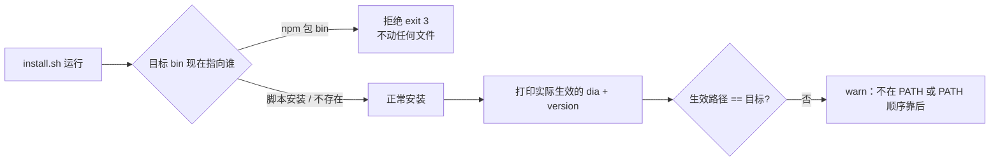

# 安装防呆：脚本安装不许抢走 npm 全局安装

> 日期：2026-11-06 ｜ 状态：**已退役（2026-11-09：install.sh 删除，安装只走 npm）** ｜ 触发：同一台 Linux 机器 3 次出现 `~/.local/bin/dia` 被指回脚本安装
> 上游：三名独立子会话的 grill（架构/契约、红队、兼容迁移），结论一致 ｜ 判据：`bash tests/install-guard.test.sh`

---

## 1. 现象与根因

**现象**：`~/.local/bin/dia` 从 npm 包 bin 被改成 `~/.local/share/dia/bin/dia.js`，随后：

- `paths.installDir()` 按 `import.meta.url` 反推安装根 → 落在脚本安装目录
- 内置能力包 `kits/dia-msg` 去旧目录找 → `missing-kit` / `E_KIT_EMPTY`
- `dia doctor` 红、`dia update` 走脚本模式（自己 `git pull && bun run build && bash install.sh`，再抢一次）

**根因**：`install.sh` 第 58 行 **无条件** `ln -sfn "$DIA_INSTALL_DIR/bin/dia.js" "$DIA_BIN_DIR/dia"`。
两种安装共存本身不是错误（npm 可以装在别的 prefix），错误是**后来者覆盖了正在生效的那条链接**。



## 2. 被否掉的初版方案

初版设想是「检测到 npm 全局包存在就拒绝」。grill 三方一致否掉，理由：

| 问题 | 证据 |
|---|---|
| 两种安装可以合法共存 | 本机 `npm prefix -g` 有 `@minonl/dia`，同时 `~/.local/bin/dia` 是脚本安装，两者并存且脚本版更新 |
| npm 包可能是**旧残留** | npm 0.0.13 + 脚本 0.0.15 时，拒绝安装等于**永久锁死升级** |
| 多 Node 前缀 | fnm/nvm 切版本后 `npm ls -g` 结果就变，检测不稳定 |
| 依赖 npm 命令 | 无 npm 的容器/离线场景会误伤；且 `npm ls` 有 0.5s 启动成本 |

## 3. 决定（三条）

**D1 判据 = 抢链接，不是「包存在」**

```
pkgOwned(p)：三种形态任一命中即算包管理器全局安装
  A 软链/拷贝：逐级解析符号链接后，真实路径匹配 (/|\\)node_modules(/|\\)@minonl(/|\\)dia
  B shim 脚本：目标文件不是软链，内容含 @minonl/dia 或 node_modules/(@minonl/)?dia/
  C 二进制 shim：所在目录是已知包管理器全局 bin（~/.volta/bin、PNPM_HOME 等）
```

只在这些情况拒绝（且该路径正是 `command -v dia` 会命中的那条）：

1. `$DIA_BIN_DIR/dia` 的 realpath 落在 `node_modules/@minonl/dia`（npm / bun 全局安装）；
2. bin 是 **shim 脚本/拷贝**且内容带包路径（pnpm / yarn-berry）；
3. bin 所在目录属于已知包管理器全局 bin（volta 这类不含包路径的同名 shim）。

包存在但 bin 未被占 → **只 warn 一行，继续安装**。

> 红队回灌（2026-11-06，实现后）：`--home` 独占**不算**沙箱（链接仍写默认 bin，守卫照旧生效）；
> 链接落位失败必须退 1（不再谎报装好）；`--migrate` 改为**只搬数据**（不装、不改 bin）。

> 为什么要有 B/C：pnpm / yarn-berry / volta 的全局 bin 是 **shim 脚本或同名二进制**，不是指向
> `node_modules/@minonl/dia` 的软链。只认软链时守卫会把这些安装判成「脚本安装」并静默覆盖，
> 事故形态与 npm 完全一致（本仓库 packageManager 就是 pnpm）。

**D2 退出码 3 + 显式逃生舱**

| 码 | 含义 |
|---|---|
| 0 | 装好（含「已警告但仍安装」） |
| 1 | 前置缺失（缺 `dist/cli.js` / `bin/dia.js`） |
| 2 | usage |
| **3** | **守卫拒绝：未改动任何文件**（可安全重试，重试必然同样结果） |

放行条件（任一命中即跳过守卫）：

- `DIA_ALLOW_SCRIPT_INSTALL=1`（人类显式意图）
- `--dry-run`（只演练）
- **生效 bin 目录被重定向**：`--bin DIR` / `DIA_BIN_DIR=DIR`，且不等于默认 `~/.local/bin`

> **只改安装目录不算沙箱**（`--home` / `--install-dir` / `DIA_INSTALL_DIR` / `DIA_HOME_INSTALL`）：
> 链接仍写在默认 `~/.local/bin/dia`，照样会抢走生效安装，守卫必须照旧生效（exit 3）。
> 想要「不碰生效路径」的沙箱，必须同时指定 `--bin`。

**D3 `dia update` 不硬失败**

脚本模式下**保持现状**（打印升级指引、exit 0），不升级为错误：否则「脚本安装的机器」会彻底无法升级，且 CI 里 `update` 测试会红。只加一条：若检测到 npm 包与当前安装不一致，多打印一行 `dia doctor` 提示。

## 4. 配套

**D4 安装后自检**：`install.sh` 结束时打印

```
dia installed: <install dir> → <bin dir>/dia
effective: <realpath of $(command -v dia)> (<version>)
```

生效路径 != 目标时 warn（这正是「npm 装到不在 PATH 的 prefix」的可见化）。

**D5 `dia doctor` 新增 `install_shadow`（fail）**

判定：`installDir()` 不是包管理器安装 + `command -v dia` 解析到包管理器安装（或反过来）→ 报不一致，附修复命令。
包管理器安装的 bin 是 shim（pnpm/yarn）时按脚本内容识别，不只看 realpath：

```bash
ln -sfn "$(npm prefix -g)/bin/dia" ~/.local/bin/dia
```

**D6 原子写**（低成本顺带）：`cp` 落 `<file>.tmp` 再 `mv -f`；`ln -sfn` 改「先建临时链接再 rename」，避免并发会话看到半截文件/短暂无命令。

## 5. 失败模式（红队保留项）

| 场景 | 处理 |
|---|---|
| npm 包在别的 Node 前缀 | 不检测 npm 列表，只判真实路径 → 天然不受影响 |
| pnpm/yarn/bun/volta 全局装 | 软链看 realpath（`node_modules/@minonl/dia`）；shim 看内容（`@minonl/dia`）；volta 二进制 shim 看全局 bin 目录归属 |
| 只改安装目录当沙箱 | 不算沙箱：链接仍写默认 bin，守卫照旧 exit 3；沙箱必须重定向 `--bin`/`DIA_BIN_DIR` |
| `readlink -f` 在 macOS 不存在 | 用 `cd "$(dirname x)" && pwd -P` 逐级解析，两边同构 |
| 本机测试被守卫误拦 | 测试全部用临时 `DIA_INSTALL_DIR` + 临时 `DIA_BIN_DIR`（= 沙箱放行），不探测真机环境；只给安装目录的用例应得 rc=3（`tests/install-guard-strict.test.sh` ①） |
| 上层脚本把 exit 3 当致命 | 文案给出三条出路（显式放行 / 回 npm / 换 `--bin` 沙箱）；`docs/` 里所有 `bash install.sh` 用法补注「默认路径已被包管理器占用时会拒绝」 |
| 老版本 dia 没有防呆 | `doctor install_shadow` 负责发现，修复命令一条 |

## 6. 判据（可执行）

```bash
# 1) 目标 bin 被包管理器占用（**默认路径**）→ 拒绝，且链接字节不变
#    自动化等价物：tests/install-guard.test.sh ①（临时 HOME + 临时 PATH + 伪 npm 包）
# 1b) shim 形态（pnpm/yarn/volta）→ 同样拒绝；只改安装目录（--home 等）→ 同样拒绝
#    自动化等价物：tests/install-guard-strict.test.sh ①②
# 2) 真沙箱（**bin 目录**被重定向）→ 放行
DIA_INSTALL_DIR=/tmp/x DIA_BIN_DIR=/tmp/xbin bash install.sh; test $? -eq 0
# 3) npm 包存在但 bin 未被占 → warn 但安装（install-guard.test.sh ③）
# 4) doctor：真实路径与 installDir 不一致 → install_shadow fail
dia doctor | grep -q install_shadow
# 5) npm 安装的机器上：installDir 含 node_modules/@minonl，且 kits/dia-msg 可解析
dia doctor --paths | grep -q 'node_modules/@minonl'
```

## 7. 不做的

- **不做 `dia install repair`**：新增命令面大于收益；doctor 给一行可复制命令即可。
- **不改 `dia update` 退出码语义**：`--check` 的 0/1 语义保持不变。
- **不引入 npm 依赖检测**（`npm ls -g` / `npm prefix -g`）：确定性优先。

## 8. 文档同步

`README.md`（安装章节）、`docs/cli.md`（`doctor` 检查项）、`docs/kit-install.md`（install.sh 分发说明）、
`docs/status.md`（新增条目）、`docs/index.md` + `llms.txt`（新文档索引，改完跑 `npm run docs:index`）。
