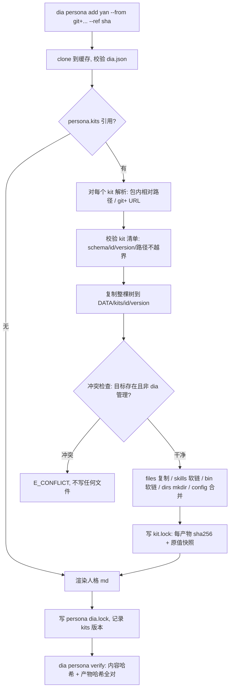

# Kit：内容包安装（persona 的第二个半边）

> 日期 2026-10-30。前置：`docs/persona-install.md`（persona = 人格，kit = 内容）。
> 本文只定 **kit 的清单格式、渲染规则、生命周期、边界**；实现拆到 P1/P2/P3。

---

## 0. 一句话

**persona 决定「你是谁」，kit 决定「你会什么」**：人格 md 之外的一切静态内容——知识树、skill、PATH 命令、
宿主配置文件、运行时目录——都由 kit 声明式分发，dia 负责复制、记账、校验、回滚。

---

## 1. 现状缺口（为什么需要它）

`dia persona add yan` 现在的产物只有 `~/.config/opencode/agents/yan.md`（3522 字节）。而 yan 的最小可用状态还差：

| 缺的东西 | 现在由谁做 | 后果（干净机器上） |
|---|---|---|
| `core/knowledge`（2.3M） | `install.sh` 软链 `core/AGENTS.md` | 人格里写的「先查库」查不到 |
| `yan-kb` / `yan-worktree` 等 PATH 命令 | `install.sh` → `scripts/install-cli` | `yan-kb --scene S1` 直接 command not found |
| `core/skills/yan-onboarding` | 软链到各宿主 skill 目录 | onboarding 不会触发 |
| `~/.config/opencode/AGENTS.md` | 软链 `core/AGENTS.md` | 全局规则不生效 |
| 宿主配置（default_agent / permission） | `ensure-permission.py` 改 JSON | 权限白名单缺，读写被拦 |
| 数据根目录树 | `install.sh` mkdir | 首次运行写失败 |

结论：**persona 装完是"哑"的**；kit 就是把这些补上，且要能 `verify` / `remove`。

---

## 2. 清单：`dia.json`（kind=kit）

```json
{
  "schema": 1,
  "kind": "kit",
  "id": "yan-core",
  "version": "0.1.0",
  "root": ".",
  "files": [
    { "from": "core/AGENTS.md", "to": "~/.config/opencode/AGENTS.md" },
    { "from": "core/AGENTS.md", "to": "~/.codex/AGENTS.md" }
  ],
  "skills": [
    { "from": "core/skills/yan-onboarding", "name": "yan-onboarding", "mode": "link" }
  ],
  "bin": [
    { "from": "scripts/yan-kb", "name": "yan-kb" },
    { "from": "scripts/yan-worktree", "name": "yan-worktree" }
  ],
  "dirs": [
    "~/.yan-agent/cache",
    "~/.yan-agent/backups",
    "~/.yan-agent/tasks",
    "~/.yan-agent/observability"
  ],
  "config": [
    {
      "file": "~/.config/opencode/opencode.json",
      "jsonc": true,
      "set": { "permission.external_directory": { "~/.yan-agent/**": "allow" } }
    }
  ],
  "knowledge": ["core/knowledge"],
  "requires": { "dia": ">=0.1.0" }
}
```

字段语义：

| 字段 | 语义 | 渲染方式 |
|---|---|---|
| `root` | 包内**运行根**：bin / knowledge / AGENTS.md 相对它解析 | 安装后 rider 根 = `<DATA>/kits/<id>/<version>/<root>` |
| `files` | 单文件 → 目标路径 | **复制**（内容哈希记账） |
| `skills` | 目录 → 宿主 skill 目录 | `mode: link` 软链回 kit 根（单源）；`copy` 独立复制 |
| `bin` | 脚本 → `~/.local/bin/<name>` | **软链**回 kit 根（脚本靠自身 realpath 推根，见 §3.2） |
| `dirs` | 运行时目录 | `mkdir -p`，**remove 时不删**（可能已有用户数据） |
| `config` | 宿主 JSON 配置合并 | P2 实现；写前记录原值，remove 按记录还原 |
| `knowledge` | 声明给 `dia kb` 用的知识根 | 不复制，只在 `dia kit show` 里暴露绝对路径 |

**为什么 `root` 而不是逐文件列**：yan 的脚本自己解析 `REPO_DIR`（`scripts/yan-kb` 靠 `SELF_DIR/..`），
如果只把 `scripts/yan-kb` 单文件搬到 `~/.local/bin`，它找不到 `core/knowledge`。整棵树进 kit 根，软链回原处，脚本零改动。

---

### 2.1 persona 可自带内容（内联 kit）——已定案（2026-10-30）

```json
{
  "schema": 1, "kind": "persona", "id": "yan", "version": "0.1.0",
  "entry": { "opencode": "platform/opencode/files/opencode-agent-yan.md" },
  "files":   [{ "from": "core/AGENTS.md", "to": "~/.config/opencode/AGENTS.md" }],
  "skills":  [{ "from": "core/skills/yan-onboarding", "name": "yan-onboarding", "mode": "link" }],
  "dirs":    ["~/.yan-agent/cache", "~/.yan-agent/tasks"],
  "knowledge": ["core/knowledge"],
  "data_root": "~/.yan-agent",
  "commands": [{ "name": "scene", "entry": "scripts/kb-domain.mjs", "env": { "YAN_DATA_ROOT": "~/.yan-agent" } }],
  "kits": ["../shared/leyan-skills"]
}
```

persona 与 kit 用**同一套内容字段**（`files/skills/bin/dirs/commands/knowledge/data_root`），差别只在所有者：

| | 谁的内容 | 路径基准 | 生命周期 |
|---|---|---|---|
| persona 自带 | 该人格专属（规则、知识、域命令） | persona 根 | 随 persona 装/卸 |
| 独立 kit | 跨人格/第三方复用（共享 skill 包） | kit 根 | 独立装/卸，可被多 persona 引用 |

**为什么要有这一层**：把 `core/knowledge` 搬进 `kits/yan-core/` 要改 46 处脚本、65 个 md 的硬编码路径，
收益只是"目录好看"。内联后 persona 根就是内容根，历史路径零改动；复用需求一旦出现，再拆独立 kit 即可。

实现上两者共用 `kit.renderContent(baseDir, targetDir, manifest)`：persona 传 `baseDir = targetDir = persona 树`，
kit 传 `baseDir = 包内目录, targetDir = DATA/kits/<id>/<version>`。

---

## 3. 安装管线



### 3.1 复制还是软链

| 类别 | 选择 | 理由 |
|---|---|---|
| kit 内容树 | **复制**到 `DATA/kits/` | 与 persona 一致；源仓可移动/删除；`verify` 有稳定基准 |
| `bin` | **软链**到 kit 根 | 脚本必须能反推 `REPO_DIR`；复制单文件会打断 |
| 内部 skill | **软链**到 kit 根 | 与 `install.sh` 现有行为一致（`core/skills/yan-onboarding`） |
| `files`（AGENTS.md 等） | **复制** | 宿主只读文件；软链会让宿主读到 `.git` 里的脏状态 |

### 3.2 bin 软链为什么能工作

`scripts/yan-kb` 解析真实路径链（`while [ -L ... ]`）→ `<DATA>/kits/yan-core/0.1.0/scripts/yan-kb`，
`SELF_DIR/..` 即 kit 根，`core/knowledge` 就地可读。**不需要**任何 `YAN_REPO_DIR` 环境变量，也不需要 install-cli 生成启动器。

### 3.3 幂等与升级

- 同 `<id>@<version>` 重装：内容哈希一致 → 无写入，返回 `unchanged`；
- 换版本（`dia kit update`）：旧目录保留（多版本共存），产物按 lock 备份后重写，`dia kit gc` 清理非当前版本；
- persona 与 kit 版本联动：persona 的 `dia.lock` 记录 `kits: {"yan-core": "0.1.0"}`，`persona verify` 一并校验。

---

## 4. 生命周期与退出码

| 命令 | 行为 | 关键约束 |
|---|---|---|
| `dia kit add <src> [--ref]` | 取回 → 校验 → 复制 → 渲染 → lock | 不执行任何脚本 |
| `dia kit list` | 已装 kit + 版本 + 产物数 | 只读 |
| `dia kit verify <id> [--version]` | 内容哈希 + 每个产物哈希 | 不一致 → exit 21（`E_HASH`） |
| `dia kit update <id> --ref` | 新版本 → 备份旧产物 → 重渲染 | 破坏性变更提示 |
| `dia kit remove <id>` | 只删 hash 匹配的产物；手改过的**拒绝删并列出** | exit 0 附 `skipped[]` |

沿用 persona 的退出码：`E_MANIFEST` 20 / `E_HASH` 21 / `E_CONFLICT` 32 / `E_HOST` 33 / `E_SOURCE` 34（新增：源不可达）。

---

## 5. 边界（明确不做）

1. **不执行安装脚本**：kit 里写 `install.sh` 也不跑（与 persona 同）。
2. **不装第三方包**：`npx skills add` 出来的 leyan-skills 等**不由 kit 管**；kit 只声明 `requires.npx` 并在缺失时 `W_` 告警。
3. **不管卸载服务**：launchd/cron 任务归 `dia job`，kit 不创建任务。
4. **不写默认 agent**：`default_agent` 只允许通过 `config` 显式声明（P2），且必须可回滚；kit 不猜。
5. **不碰用户手改**：产物哈希不匹配一律 skip，不覆盖、不删除。

安全（沿用 persona §4）：来源白名单（git host + owner）、`--ref` 解析成 commit sha 落 lock、路径不得越出包根、`--dry-run` 列出将写入的每个路径。

---

## 6. 命令面：装完之后的命令不是 `yan-kb`

安装只是让内容到位；**入口也要归一**，否则 kit 只是把旧脚本换个地方放。

### 6.1 原则：一个入口 `dia`，加 persona 作用域

```bash
dia --persona yan kb query "MR 合并"      # 显式作用域
DIA_PERSONA=yan dia kb query "MR 合并"    # 会议/脚本里设一次
```

作用域解析链（`--persona` > `DIA_PERSONA` > 唯一已装 persona）：

```text
--persona yan
  → DATA/personas/yan/<ver>/dia.lock.kits          # 该人格引用了哪些 kit
  → kit.knowledge → <kitroot>/core/knowledge        # 知识根
  → kit.data_root → ~/.yan-agent                    # 运行时数据（db/backups/tasks）
  → 不在 persona 作用域里时，退回 `--root` / cwd（旧行为）
```

**为什么要 `--persona` 而不是 `--root`**：`--root` 只解决"读哪棵树"，解决不了"用哪个数据根、哪些域命令可用、
哪个 db 文件"。这些是人格的属性，不是目录的属性。

### 6.2 映射表（旧 → 新）

| 旧命令 | 新命令 | 备注 |
|---|---|---|
| `yan-kb "意图"` | `dia kb query "意图"` | 默认 path：KB 物理进 dia，命令名跟着进 |
| `yan-kb --scene S1` | `dia kb scene S1` | 域语义，经委派（§6.3） |
| `yan-kb --rule R25` | `dia kb rule R25` | 同上 |
| `yan-kb --auto "…"` | `dia kb auto "…"` | 同上；UNKNOWN 仍 exit 5 |
| `yan-kb record gap\|decision\|note` | `dia kb record …` | 委派到 yan 实现（写入目标文件是域事实） |
| `yan-kb report` / `path` / `claims` / `baseline` / `alerts` | `dia kb <同名>` | 前两个内置，其余委派 |
| `yan-kb doctor` | `dia doctor --persona yan` | 组合自检归 dia |
| `yan-worktree create\|clean\|check\|scope\|route` | `dia wt create\|clean\|check\|…` | `packages/wt`，§7 |
| `yan-task list\|status\|install…` | `dia job <同名>` | 已完成（`packages/job`） |
| `yan-version` | `dia persona show yan` | 版本 = persona 版本 + lock 里的 commit |

### 6.3 域语义怎么落：子命令委派（`git-foo` 机制）

内置子命令之外，`dia kb` 查 persona 已装 kit 的 `commands` 声明，命中就委派：

```json
"commands": [
  { "name": "scene",    "entry": "core/knowledge/scripts/kb-scene.mjs",    "runtime": "bun|node" },
  { "name": "rule",     "entry": "core/knowledge/scripts/kb-rule.mjs" },
  { "name": "auto",     "entry": "core/knowledge/scripts/kb-auto.mjs" },
  { "name": "record",   "entry": "core/knowledge/scripts/kb-record.mjs" }
]
```

行为约定：`argv` 原样透传、`cwd` 不变、`YAN_*` 等 persona 环境变量由 dia 注入、**子进程 exit code 原样返回**
（`--auto` 的 UNKNOWN=5 语义不能丢）。

好处：`dia` 不需要认识 scene/rule/claims；域实现仍住在 yan 仓，随 kit 版本走；命令面只有一个。

### 6.4 不做 shim：一步切换

**决策（2026-10-30，用户拍板）**：不留 `yan-*` 转发 shim，安装产物里**没有任何 `yan-` 前缀命令**。

1. `yan-kb` / `yan-worktree` / `yan-task` / `yan-doctor` 等脚本从 yan 仓**删除**，逻辑进 dia（`packages/*`）或作为
   kit 的 `commands` 扩展；不是保留转发。
2. 因此迁移验证只在**开发侧**做一次对照（同一份数据新旧各跑一遍，比对输出），对照脚本随老代码一起删，不随包分发。
3. 文档引用就地改写（`yan-kb` 131 处 / `yan-worktree` 99 处 / `yan-task` 282 处），与代码删除同一个 MR/commit。
4. **扫描门禁**：yan 仓 CI 加一条 `grep -rE "\byan-(kb|worktree|task|doctor|env|ref|mr|schedule|version)\b"`
   白名单外命中即失败——防止回潮。

---

## 7. worktree：`dia wt`（`packages/wt`）

`yan-worktree` 1160 行、5 套测试（`check`/`clean`/`prune-merged`/`route`/`scope`）。归属 `packages/wt`（monorepo 先例：`packages/job`）。

| 抽取项 | 处理 |
|---|---|
| `YAN_DATA_ROOT` / `tasks/scopes` | 参数化为 `DIA_WT_DATA_ROOT`（persona 注入 `~/.yan-agent`） |
| `~/repos/leyan` 默认 | `DIA_WT_REPOS_ROOT`，缺失时不猜、报错 |
| `YAN_SESSION_ID` | `DIA_SESSION` |
| 直推 vs MR（`my_namespaces`/`direct`/`mr`） | **留 yan 域**，经 §6.3 委派（`dia wt route` → yan 扩展） |
| `route_config_json` 里的 python3 heredoc | 换 Node JSON（`packages/job` 同款，dia 禁止 python） |

**已落地（2026-10-30）**：`packages/wt/bin/dia-wt`（bash，与 `packages/job` 同模式）+ `packages/cli` 的 `dia wt` 转发 + `install.sh` 分发。
env 全部改 `DIA_WT_*` / `DIA_SESSION`；7 处 python3 全部换成 Node（含 node_modules 扫描器），包内 python 归零。
测试 4 套原样迁移全绿（check 27 / clean 20 / prune-merged 31 / route 26）；`scope` 16 项全绿，**其中「与 yan 权限层串联判定」1 项已移出**——
那是 yan 域契约，不属于 dia wt。levm 上 `create → status → clean` 实跑通过。

验收：**开发侧一次性对照**（旧脚本 vs `dia wt`，同仓同分支跑一遍
`create/check/clean` 比对输出与 `git worktree list`）——因为 worktree 有分支与文件系统副作用，切错不便宜。
对照完成后旧脚本即删，不随包分发。

---

## 8. 与 yan-agent@next 的对接（迁移顺序）

```mermaid
flowchart LR
  subgraph 现在
    Y1[yan-agent@next<br/>install.sh 装全部]
  end
  subgraph 目标
    P[dia.json persona: yan<br/>entry = 人格 md]
    K[dia.json kit: yan-core<br/>files/skills/bin/dirs/config]
    D[dia persona add yan]
    D --> P
    D --> K
  end
  Y1 -.拆.-> P
  Y1 -.拆.-> K
```

| 阶段 | 动作 | 门禁 |
|---|---|---|
| **K1** | kit 清单 + 复制/软链/记账/verify/remove（不含 `config`） | 隔离 HOME：`kit add` → `verify` → `remove` 无残留 |
| **K2** | `config` 合并（opencode.json permission / default_agent），带原值快照回滚 | remove 后 opencode.json 与装前逐字节一致 |
| **K3** | yan@next 落地 `dia.json`(persona) + `kits/yan-core/dia.json`（含 `commands` 委派） | 干净 VM：`dia persona add yan --from <gitlab> --ref <sha>` 后 `dia --persona yan kb scene S1` 可跑 |
| **K4** | 删 `install.sh` / `uninstall.sh` / `scripts/yan-*`，入口只剩 `dia persona add` + `dia job bootstrap` | 仓内 `grep -rE "\byan-(kb|worktree|task)\"` 仅剩知识文档里的新命令名 |

**验收（K3 定义「装好了」）**：
1. 干净 HOME（无 `~/.yan-agent`、无 `yan-kb`、无 `agents/yan.md`）；
2. `dia persona add yan --from <gitlab-url> --ref <sha>` 单命令完成；
3. `cd /tmp && dia --persona yan kb scene S1` 出场景卡（证明知识根 + 数据根 + 委派都对）；
4. `dia persona verify yan` → ok；`dia kit verify yan-core` → ok；
5. `dia persona remove yan` → `~/.yan-agent` 运行数据保留、所有渲染产物消失、无断链。

---

## 9. 实施状态（2026-10-30）

| 阶段 | 状态 | 证据 |
|---|---|---|
| K1 kit 安装器 | ✅ | `src/kit.ts` + 9 例单测 |
| K1.5 作用域 + 委派 | ✅ | `src/scope.ts`、`dia --persona yan kb scene S1` |
| K2 persona 内联内容 | ✅ | `renderContent(baseDir, targetDir)` 两处复用 |
| K3 yan@next 形态 | ✅ | `feat/dia-persona` 分支；levm 实装通过 |
| K4 worktree → `packages/wt` | ✅ | 7 处 python→node；5 套测试；`dia wt create/status/clean` levm 通过 |
| K4 删旧命令面 | ✅（部分） | 删 yan-kb / yan-worktree / yan-task / 旧安装器；CI 门禁上线 |
| K4 未迁移项 | ⏳ | `yan-mr` / `yan-release` / `yan-env` / `yan-ref` / `yan-schedule` / `yan-doctor` / `yan-version` / `yan-data-root` 仍在仓内、不随 persona 安装 |
| P2 config 合并 | ⏳ | opencode.json 的 permission / default_agent 仍靠人工或旧残留 |

---

## 10. 待拍板（实现前需要人确认）

1. **kit 与 persona 是否同仓**：本文假设同仓、persona 用相对路径引用（`"kits": ["./kits/yan-core"]`）。若要支持独立 kit 仓（`git+…`），清单里就写 URL，实现多一条解析分支。
2. **`config` 合并放 P1 还是 P2**：放 P1 能一次装到「开箱可用」，但要引入 JSONC 读写与回滚记账；放 P2 则先装内容、权限靠用户手动或旧 install.sh 兜一次。
3. ~~命令面切换的节奏~~ **已定**：不留 shim，一步切（§6.4）。
4. **`dirs` 的 remove 语义**：本文取「不删」（可能已有任务/备份数据）。若要删，需 `--purge-data` 且二次确认。
