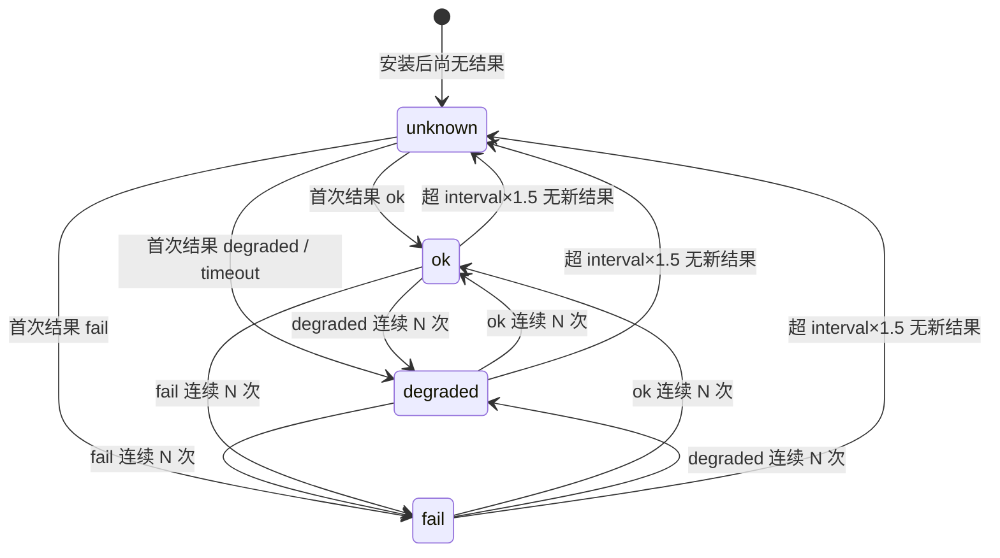
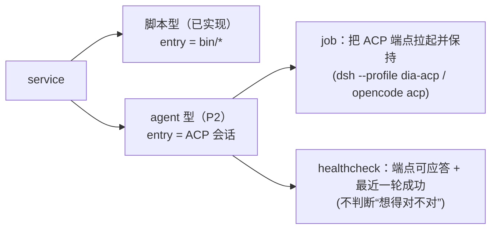

# 服务（service）：可托管的执行体

> 状态：**已实现（v0.0.10，脚本型 + agent 型）**。脚本型走 `entry.cmd`，agent 型走 `entry.agent` + `healthcheck.kind="acp"`；
> healthcheck 按专用码域 `0/20/21` 判定（外加 `124`=timeout、信号=crash），旧结果超新鲜度窗口即报 `unknown (stale …)`。
> **实现状态逐节对照见 §15。**
> 日期 2026-11-05（rev.2：按 [设计评审 B1–B5 / C1–C7 / D1–D4](review/service-noun-review-2026-11-05.md) 改稿；
> **rev.3**：按复核意见改「去抖单一写入方 / health 码域 `0/20/21` / timeout 映射 / 手动检查落台账 / adopted 口径」，见 §13；
> **rev.4**：回填实现状态（PR #49 / #54 / #60）与 §15 对照表）。
> 关联：[`cli.md`](cli.md)（名词与动词矩阵 / 退出码）· [`persona-install.md`](persona-install.md)（`dia.json` schema）·
> [`kit-install.md`](kit-install.md) · [`acp-integration.md`](acp-integration.md)（agent 会话型服务）· `packages/job`（生命周期、状态台账）

## 0. 一句话

**persona 决定「你是谁」，kit 决定「你会什么」，service 决定「你在后台干什么、活没活着」。**

**本版只做脚本型服务**（entry 是仓内可执行文件）。entry 是「persona 会话」的 agent 型服务**本版不做**，
其存活/健康由 ACP 侧（`docs/acp-integration.md` 的 daemon 讨论）负责，留作 P2（见 §9）。

## 1. 缺口

现有名词只覆盖前两件事：

| 名词 | 管什么 | 不管什么 |
|---|---|---|
| `persona` | 可被选中的 agent 定义（entry / hosts / capabilities / kits） | 后台常驻、调度、健康 |
| `kit` | 知识 / 技能 / PATH 命令 / 配置，**无执行权**（`kit add` 不执行脚本） | 进程、定时、日志 |
| `job` | 调度与生命周期（launchd / cron / systemd / schtasks） | 「这个东西是什么」「入口在哪」「算不算健康」 |

后果：**每个服务仓自己写一遍契约**（README 写 install 命令、自己定义「什么算健康」、自己写卸载脚本），
彼此不一致；「进程活着但三天没干活」没有任何一层能发现。

## 2. 构成

```
service = entry（脚本入口）                       ← 本版只此一种
        + lifecycle（job：periodic / bounded / service）
        + contract（stdin / 生命周期退出码 / 幂等键 / 日志）
        + healthcheck（可选；专用退出码域，见 §4）
        + 可选 kits（内容依赖）
```

- **是**一个可被托管的执行体
- **不是** kit（无执行权）、**也不是** persona（脚本型服务不需要「人格/会话」）
- **契约分两套码域**：`contract.exit`（服务自己的业务/生命周期语义，**dia 不解读**）与 `healthcheck` 专用码
  （`0/2/3`，**dia 判定的唯一输入**）。两套**物理分离**，同一次运行里互不借用（见 §4.1 与 §7 的隔离规则）。

## 3. 清单（`dia.json`，`kind=service`）

与 persona / kit **共用 `dia.json` 格式与 `schema: 1`**（校验器共用同一套顶层规则：`schema` / `kind` / `id` / `version`，
见 [`persona-install.md`](persona-install.md) §2），按 `kind` 分派到 `entry` / `lifecycle` 等专属字段。

```jsonc
{
  "schema": 1,
  "kind": "service",
  "id": "example-worker",
  "version": "0.1.0",
  "entry": { "cmd": "bin/example-worker" },          // 稳定入口：仓内相对路径 | 已安装 ref-entry；禁止 checkout 绝对路径
  "lifecycle": { "type": "periodic", "interval": 300, "target": "local" },
  "contract": { "stdin": "json", "exit": "0=ok/2=retry", "idempotent_by": "event_id" },  // 只声明，不参与 health 判定
  "healthcheck": {
    "cmd": "bin/healthcheck --json",                  // 服务自己给的判据；专用码 0/2/3
    "interval": 1800,                                 // 默认 1800s；须 ≥60s、整分；cron 后端还要求 ≤23h 且整数小时后整除 24
    "timeout": 60,                                    // 默认 60s；由 dia 包装超时
    "ok_exit": [0],
    "degraded_exit": [2],
    "fail_exit": [3],
    "debounce": 2                                     // 默认 2：连续 N 次同结果才切换状态
  },
  "kits": [],
  "requires": { "dia": ">=0.1.0" }
}
```

| 字段 | 语义 |
|---|---|
| `entry.cmd` | **稳定入口**，两种合法形态（对齐 `packages/job` 的 ref-entry 判定，`lib/policy.sh`）：<br>① 仓内相对路径（`bin/*`）：`add` 时解析并链接到 `DIA_JOB_ENTRY_DIR`（默认 `$DIA_JOB_ROOT/bin` → `~/.local/bin`），**存 registry 的是链接后的稳定入口**；<br>② 已安装的 ref-entry（`$DIA_JOB_ENTRY_DIR/*`）。<br>禁止 checkout 绝对路径 / worktree 路径（`E_UNSTABLE_ENTRY`） |
| `lifecycle.type` | `periodic` / `bounded` / `service`（直接映射 `dia job install --type`） |
| `lifecycle.interval` | periodic 的间隔；**cron 约束**：`≥60s` 且为整分；用 `*/N` 分表达时 `N` 必须整除 `1440`（24h）；间隔 `>23h` 表达不了 → **安装期显式 `E_BACKEND`**（与 `cron_spec` 的 `rc=3` 对齐），绝不上装半套 |
| `lifecycle.target` | `local` / 主机名：多机部署时的归属声明，供 `status` 提示。比对口径：`os.hostname()` 与声明值均**去 `.local` 后缀、转小写**后比较（D3） |
| `contract` | 与调用方/事件源的约定（stdin 格式、生命周期退出码语义、幂等键）**只声明，不执行、不参与 health 判定** |
| `healthcheck` | 见 §4；缺省表示「只报生命周期状态」，`status` 显示 `health=n/a` |

## 4. healthcheck 契约（本提案的核心）

> 目的：区分「**进程在**」与「**在干活**」。前者 `job` 已经能答，后者只能由服务自己答。

### 4.1 判据：专用退出码域（与 `contract.exit` 物理分离）

| healthcheck 退出码 | 结果 | 说明 |
|---|---|---|
| `0`（`ok_exit`） | `ok` | |
| **`20`**（`degraded_exit`） | `degraded` | 落后 / 正在重试，**不是 fail** |
| **`21`**（`fail_exit`） | `fail` | |
| **`124`**（wrapper 的 `timeout(1)`） | `degraded`（明细 `timeout`） | **参与去抖**（与 20 同权）；不杀服务本身 |
| 被信号杀死（**137/143**） | `crash` | 见 §4.4；**不参与去抖** |
| 其它非 0 码 | `crash` | 判据不可用 |
| stdout 有 JSON 但不可解析 | `crash` | 与崩溃同处理，**不冒充 ok/fail** |

> **为什么是 `20/21` 而不是 `2/3`**：`packages/job` 的 wrapper 兜底映射把 `2` 记 `degraded`、`3` 记 `failed`
> （`packages/job/bin/dia-job`），`contract.exit` 也用 `0=ok/2=retry`。若 health 复用 `2/3`，
> 一旦有人把 healthcheck 误装成普通任务，同一个码会被读成两套含义（B1 要排除的正是这个）。
> `20/21` 落在 job 未使用的区段，**物理上不可能撞车**；`ok_exit` / `degraded_exit` / `fail_exit` 仍可覆盖。
> ⚠️ **码域分离 ≠ 存储分离**：健康结果仍写在同一 `state.jsonl`（§4.5），靠 `kind` 区分行；分离只发生在解析层。

- **`dia job` 的 `0/1/2/3/4/5`、`cli.md` 的 `0/2/30/31/32/33`、`contract.exit` 的 `0=ok/2=retry` 都不参与 health 判定**；
  health 只用 `0/20/21`（外加崩溃/超时的信号与 124 语义）。
  `contract.exit` 描述的是「服务跑一轮的结果」（`job` 的 wrapper 已经把它记成 `verdict`），`healthcheck` 描述的是
  「服务现在算不算健康」。两件事不同的码域，互不借用（B1）。
- 结构化输出（可选）：stdout JSON `{ "status": "ok|degraded|fail", "checks": [{ "name", "level", "detail" }] }`
- **不推断业务语义**：dia 只看退出码与（可选的）JSON 的 `status`；不认识业务字段，不根据 `checks` 自行升降级。

### 4.2 执行环境（C1 / C2）

| 项 | 约定 |
|---|---|
| 谁拉起 | `job` 后端按 `healthcheck.interval` 周期性拉起一个健康检查任务（名 `svc-<id>-health`），**不新增调度器** |
| cwd | 服务安装目录（`dia.json` 所在仓根）——与 `entry.cmd` 相对路径解析同一基准 |
| PATH | 继承 `DIA_JOB_CRON_PATH`（cron 后端在行内显式给 PATH，与现有 wrapper 一致） |
| 数据根 / 结果文件 | wrapper 已 `export DIA_JOB_ROOT` / `YAN_DATA_ROOT`；健康检查子进程额外拿到 `DIA_SERVICE_HEALTH_FILE` 指向自己的结果文件（见 §4.5） |
| 超时 | `packages/job` 的 wrapper **新增一层 `timeout(1)` 包裹健康检查子命令**（macOS 用 `gtimeout`，没有则 fallback 到后台 + `wait` 的看门狗），超时 → exit 124 → degraded |
| cron 表达不了 interval | 安装期拒绝（`E_BACKEND`），**不静默改成别的间隔** |

### 4.3 状态机（含去抖与新鲜度）

**dia 侧状态**只有四种：`ok` / `degraded` / `fail` / `unknown`。

- `unknown` = **没有可用结果**：从未检查过，或最新结果已超新鲜度窗口（§4.6）。由 **dia 侧计算**，不由服务输出。
- 「崩溃 / 判据不可用」**不再是**一个状态：见 §4.4。



- **首次结果直接生效**（`unknown → *` 不走去抖），因为此时没有「上一状态」可保持。
- 一旦 `unknown`（stale），**不显示上一次的 ok**；恢复新鲜时按「首次结果」规则重新生效。
- 单次 `crash` **不改变状态**（见 §4.4），所以图中没有 `* → crash` 边。

**去抖统一规则（B3）**：
- **唯一写入方**：状态机只在**执行健康检查的 job wrapper** 里推进；它每跑一次就把「结果 + 已决定状态 + 计数」写进 §4.5 的台账。
  `dia job status` / `dia service list` **只读最近一条已决定状态**，**不重算、不追溯历史**（评审复核 blocking）。
- **代际（generation）**：每次 `dia service add` / 重装都生成新 `gen`；旧代际的行**不参与**新代际的去抖计数
  （避免「重装后旧结果继续累加」）。
- 任意两个水平的切换都需要**连续 `debounce`（默认 2）次**同类结果；只有一组计数，没有特例。
- 一个结果序列 `[ok, degraded, degraded]`：ok 计数归零 → degraded 第 1 次（保持 ok）、第 2 次（切 degraded）。
- `timeout` 与 `crash` 计数方式：**`124`（timeout）算一次 degraded，与 `20` 同权参与去抖**；
  **`137/143`（被信号杀）归 crash，不参与去抖**（见 §4.4）。
- `debounce: 1` = 关闭去抖（每次结果立即生效）。

### 4.4 「检查自身崩溃」≠ `unknown`（B4）

与服务正常退出并给出 `3` 不同，**崩溃**（被信号杀、解释器缺失、输出不可解析）只能说明「这次没拿到判据」，不能说明服务坏了或好了。

| 情形 | 状态 | 记录 |
|---|---|---|
| 单次 crash | **保持上一次状态不变**（没有上一次 → `unknown`） | 记 `last_error` 事件（原因 + 退出码） |
| 连续 `debounce` 次 crash | 切到 **degraded**，明细标「判据不可用（healthcheck 连续崩溃）」 | 只切一次，不重复告警 |
| 崩溃后恢复正常结果 | 按 §4.3 去抖规则正常演进 | `last_error` 清除 |

这样 `unknown` 只剩「无结果 / 过期」一个含义，状态机不再需要在任何状态接收崩溃边。

### 4.5 结果落点：`state.jsonl` 追加 `kind:"health"` 行（B5）

**不新增文件、不新增数据根**，复用 `packages/job` 现有的 `tasks/<name>.state.jsonl` 台账：

```json
{"ts":1757050000,"kind":"health","service":"example-worker","gen":"g-7f3a","source":"schedule",
 "state":"ok","candidate":"ok","streak":2,"raw":"ok","exit":0,"timeout":false,"detail":""}
```

| 字段 | 作用 |
|---|---|
| `gen` | 代际 id（`add`/重装时变）→ 旧代际行不参与新代际去抖 |
| `state` | **已决定**的状态（唯一写入方算好） |
| `candidate` / `streak` | 去抖的候选与连续次数（供审计/排障；读取方**不**据此重算） |
| `source` | `schedule`（job 周期） / `manual`（`dia service health`） |
| `timeout` | 本次是否超时（与 `exit:124` 对应） |

- 现有行（`{"ts","exit","verdict","errors"}`）**保持不变**，靠 `kind` 区分（无 `kind` 的历史行视为 `run`）。
- 读取：`packages/job/lib/json.mjs` 新增 `state-last --kind health`（取最后一条匹配行，找不到返回空），
  dia 侧与 `dia job status` 共用这一实现。

### 4.6 新鲜度条款（B2）

- 状态展示必须带**新鲜度**：`health=ok (5m ago)`。
- 若 **距最近一条 health 结果 > `interval × 1.5`** → 状态列显示 `unknown (stale 47m)`，**不再显示旧 ok**。
- `dia` 只托管调度，检查由 job 后端周期性拉起；**错过检查窗口本身不算 fail**（不产生告警，只把状态降为 unknown）。
- 对 `dia job status`：**只读缓存**（最近一条 health 行 + 时间戳），零执行、零网络 IO。
  「不阻塞」的口径见 §10：status 延迟**不随服务数线性增长**，基准 ≤ 200ms（N ≤ 50）。

### 4.7 结果去向与告警

- 最近一次结果 + 时间戳并入 `dia job status`（一列 health）；历史即 `state.jsonl` 的 `kind:"health"` 行。
- 只负责「让状态可见」；要不要通知由使用者/上层策略决定（不在本提案内定渠道）。

**反例（明确不做）**：
- ❌ 用「进程 pid 存在」当健康判据（服务空转时 pid 也活着）
- ❌ 把 `degraded`（落后/正在重试）当成 `fail`（会产生噪声告警）
- ❌ 让 `contract.exit` 的 `2=retry` 被 health 读成 degraded（两套码域分离）
- ❌ dia 自己推断业务健康（它不知道业务语义）
- ❌ 超新鲜度窗口后仍显示上一次的 ok

## 5. CLI 面（与 persona/kit 动词矩阵对齐）

```
dia service add|remove|list|show|verify
dia service health <id>        # 立即跑一次（不改生命周期；结果落 health 台账，source=manual）
```

| 动作 | 行为 |
|---|---|
| `add` | 取回 → 校验清单（§3）→ 校验 entry（存在/可执行/仓内或 ref-entry）→ 转发 `dia job install`（含 `svc-<id>-health` 健康检查任务）→ 写 lock |
| `remove` | 反向：`dia job uninstall`（服务任务 + 健康检查任务）+ 回收受管产物（对称） |
| `verify` | entry 存在/可执行 + lock 的 files/sha256 与当前一致 + job registry 含该服务任务与健康检查任务（漂移 → `E_DRIFT`） |
| `health` | 跑 `healthcheck.cmd`，按 §4.1 实时判定并输出三态 JSON；**并把结果以 `source:"manual"` 追加到健康台账**（§4.5），参与新鲜度与正常去抖（单一写入方仍是这次执行本身） |
| `list --json` | 每项含 `health`（`ok/degraded/fail/unknown`）、`stale`（bool）、`checked_at`，adopted 服务为 `n/a`（D4） |

**`dia service health <id>` 退出码（C3）**：

| 码 | 含义 |
|---|---|
| `0` | ok |
| `30` | degraded（含 timeout） |
| `1` | fail |
| `31` | 判据不可用（healthcheck 崩溃 / 输出不可解析 / 服务未迁移无 `dia.json`） |
| `2` | 用法错误（未知 id、无 healthcheck） |

unknown（stale）**不单独返回**——`health` 是实时执行，不存在「过期」；
但**它会写一条 `source:"manual"` 的 health 行**，所以远端 `status` 能看到新鲜度（评审复核 suggestion）。
与 [`cli.md`](cli.md) §3 对齐：`0/2/30/31` 语义相同，`1` 是 service 子命令新增的 fail 码（`dia` 顶层其余命令不使用 `1`）。

## 6. 与 `job` 的关系

- `job` 仍是**唯一调度实现**（不新增第二套）；健康检查任务本身就是一个 `job`（`periodic`）。
- `service` 只多一层「声明 + 校验 + 健康检查」。
- `dia job status` 的每行增加 `health=<ok|degraded|fail|unknown|n/a> (Ns ago)`（读 §4.5 缓存，不执行）。**✅ 已实现（PR #54）**：
  仅对 `local.dia-job-svc-<id>` 行追加，其它行原样（向后兼容）。
- 对 `service` 型（常驻）任务：Linux 走 systemd `--user`，**常驻需 `loginctl enable-linger`**（`job doctor` 已提示，`dia service add` 一并转述）；
  对 `periodic` 任务，cron 后端**没有进程状态**，health 是唯一判据 → 新鲜度条款（§4.6）尤其关键。

## 7. 边界与异常

| 场景 | 行为 |
|---|---|
| `entry` 是绝对路径 / 在仓外 / 指向 worktree | `E_UNSTABLE_ENTRY`（历史教训：清理 worktree 后 127/78 静默死亡） |
| `entry` 是 ref-entry（`$DIA_JOB_ENTRY_DIR/*`） | 允许；`verify` 校验软链目标仍是安装目录 |
| 有 `dia.json` 但**未声明** `healthcheck` | 允许；`status` 显示 `health=n/a (no healthcheck)` —— 与 adopted 的 `n/a` 用**不同后缀**区分 |
| 未迁移的 adopted 服务（无 `dia.json`） | `list/show` 只读可见，显示 `health=n/a (adopted)`；`verify/health` 报 `E_NO_MANIFEST` 并提示补 `dia.json`（**三态口径**：`n/a (adopted)` / `n/a (no healthcheck)` / `unknown (never)`，互不混用） |
| 有 `dia.json` 但从未跑过 health | `health=unknown (never)`——**与 adopted 的 `n/a` 区分**（C6） |
| 超 `interval × 1.5` 无结果 | `unknown (stale …)` |
| `healthcheck` 超时 | degraded（明细 `timeout`），不杀服务 |
| `healthcheck` 崩溃 / 输出不可解析 | 保持上次状态 + `last_error`；连续 `debounce` 次 → degraded（§4.4） |
| `contract.exit` 与 health 码同时出现 | health 只读 §4.1 专用码，`contract.exit` 忽略（B1） |
| 平台无 job 后端 / interval cron 表达不了 | `E_BACKEND`（明确不支持，不静默装半套） |
| 多机同服务 | `lifecycle.target` 声明归属（§3 比对口径）；单写者由服务自己保证（dia 只提示） |

## 8. 迁移与兼容

- 现存「只有 README 契约」的服务 → 视为 **adopted**：`list/show` 可见（`health=n/a (adopted)`），`verify/health` 需先补 `dia.json`
- **lock 复用 persona 格式**（`files` + `sha256`，见 `persona install`），service 的 lock 只多记录 `entry` 稳定入口与两个 job 名；`verify` 的「lock hash」即指这些 files 的 sha256（C4）
- 不改变 `persona` / `kit` 语义；`kit` 仍无执行权
- 与「数据根（`~/.dia`）」迁移解耦：`service` 不引入新的根，只引用 `entry` 与 `lifecycle` 与 job 现有台账

## 9. 开放问题

1. ~~**agent 型服务**（entry 是 persona 会话）是否本版支持？~~ **已定**：本版只做脚本型；agent 型留 P2，存活/健康归 ACP 侧（D1）。
2. ~~healthcheck 结果落点~~ **已定**：复用 `state.jsonl`，追加 `kind:"health"` 行（§4.5，B5）。
3. **多个 healthcheck**：本版只允许单一 `cmd`，用它自己聚合多个检查（`checks[]`）；未来如需要再扩展为数组。
4. **与 `notify` 的关系**：只暴露状态 vs 内建告警阈值。（本提案选前者，保持职责单一。）
5. **去抖默认值 2 是否合适**：对 `interval` 很长的服务（如 1h），`debounce: 2` 意味着 2h 才切换——等待真实使用数据后再调。

## 10. 验收标准

- [ ] 单测：清单校验（字段/类型/`entry` 规则：仓内相对路径 / ref-entry / 绝对路径拒收）、退出码映射（`0`→ok、`20`→degraded、`21`→fail、`124`→degraded/timeout、`137/143`→crash、其它→crash）
- [ ] 单测：去抖——`[ok, degraded, degraded]` 才切 degraded；`debounce:1` 立即切换；`unknown → 首次结果` 不走去抖；**旧代际（`gen` 不同）的行不参与计数**
- [ ] 单测：**`124` 与 `137/143` 分流**——`124` 记 degraded 且参与去抖；`137/143` 记 crash 且不参与去抖；超时**不杀服务**
- [ ] 单测：崩溃——单次保持上次状态 + `last_error`；连续 `debounce` 次 → degraded；`unknown` 不再因崩溃产生
- [ ] 单测：**码域隔离**——同一服务声明 `contract.exit: "0=ok/2=retry"` 且 healthcheck 返回 `2` → **crash**（`2` 不在 health 码域，不被 contract 解释）；返回 `20/21` → degraded/fail；返回 `4` → crash
- [ ] 单测：**新鲜度**——结果时间戳超 `interval × 1.5` → `unknown (stale …)`，不再显示旧 ok
- [ ] 单测：**单一写入方**——`status`/`list` 只读最近一条 `state`；给一条刻意矛盾的 `candidate/streak` 历史，读取结果不变（读取方不重算）
- [ ] e2e：装一个 demo 服务 → `dia service health` 的 ok / degraded / fail 三态都能复现（退出码 0 / 30 / 1）
- [ ] e2e：`dia service add` → `dia job status` 出现 `svc-<id>-health` 任务与 `health=` 列；`remove` 后两者都消失
- [ ] 兼容：无 `healthcheck` 的 service → `n/a` 不报错；adopted 服务 → `n/a (adopted)` 只读可见；未跑过 → `unknown (never)`
- [ ] 性能：**`dia job status` 只读缓存、不执行 healthcheck**；N=50 个服务时总耗时 ≤ 200ms，且不随 N 线性增长（对比：仅 1 个服务同样 ≤ 200ms）
- [ ] cron：`lifecycle.interval` 不可被 cron 表达时 `add` 返回 `E_BACKEND`，不写任何调度条目
- [ ] `dia service list --json` 含 `health` / `stale` / `checked_at` 字段
- [ ] `dia service health` 追加 `source:"manual"` 行，且 `status` 的新鲜度随之更新

## 11. 修订说明（rev.1 → rev.2）

| 项 | rev.1 | rev.2 |
|---|---|---|
| 退出码 | §4 判定用 0/2/3，与 `contract.exit` 的 `2=retry` 冲突 | §4.1 health 专用码域，`contract.exit` 不参与判定 |
| 新鲜度 | 无 | §4.6 `interval × 1.5` → `unknown (stale …)` |
| 去抖 | 只有 `ok → degraded` 要连续 2 次 | §4.3 统一规则，`debounce` 可配 |
| unknown | 与「崩溃」混用、部分边缺失 | §4.4 unknown = 无结果/过期；崩溃保持上次状态 |
| status | 未说读缓存还是实时 | §4.6/§6 只读缓存 + 性能验收 |
| 落点 | 开放问题 | §4.5 `state.jsonl` `kind:"health"` |

## 12. 评审 check-list 回复

对应 [`review/service-noun-review-2026-11-05.md`](review/service-noun-review-2026-11-05.md) §F：

```
[x] B1  health 专用退出码域，contract.exit 不参与 health 判定            → §2、§4.1、§7、§10
[x] B2  stale 新鲜度条款（超 interval×1.5 无结果 → stale，不显示旧 ok）  → §4.6、§10
[x] B3  去抖统一规则（N 可配），状态图补全，fail→ok 也消抖               → §4.3（图 + 规则）
[x] B4  unknown = 无结果/过期；崩溃 = 保持上次状态 + last_error         → §4.4、§7
[x] B5  status 只读缓存；落点 = state.jsonl kind:health                  → §4.5、§6、§10
[x] C1  wrapper 加 timeout 包裹；cron 表达不了的 interval 显式报错       → §4.2、§3、§10
[x] C2  cwd = 安装目录；PATH 继承 DIA_JOB_CRON_PATH                      → §4.2
[x] C3  dia service health 退出码：0 / 30 / 1 / 31 / 2                   → §5
[x] C4  verify 的 lock 复用 persona 格式（files + sha256）               → §8、§5
[x] C5  entry 允许仓内相对路径（add 时链到 DIA_JOB_ENTRY_DIR）或 ref-entry → §3、§7
[x] C6  n/a (adopted) 与 unknown (never) 区分                            → §7、§10
[x] C7  验收覆盖码域冲突、新鲜度、status 基准                            → §10
[x] D1  明确「只做脚本型」，agent 型指向 ACP                             → §0、§9
[x] D2  schema 引用 persona-install.md 的 schema: 1                      → §3
[x] D3  target 比对：去 .local、忽略大小写                               → §3
[x] D4  dia service list --json 含 health 字段                           → §5、§10
```

改稿后需重新运行 `pnpm docs:index` 同步 `docs/index.md` / `llms.txt` / `llms-full.txt`。

## 13. rev.3：复核意见的处理（2026-11-05 团队复核）

> 复核结论：**无法判定**（判据 `test -s docs/service-noun.md` 只是形式判据，不构成设计验证标准）。
> 但复核给出了 7 条实质意见，逐条处理如下。

| # | 级别 | 意见 | 处理 |
|---|---|---|---|
| V1 | **blocking** | 去抖不能跨一条共享台账（重装后旧结果参与计数；读取方重算会矛盾） | §4.3 增加「**唯一写入方 = 执行健康检查的 wrapper**」+ **代际 `gen`**（旧代际行不参与）；§4.5 台账增加 `state/candidate/streak/gen`；读取方只读已决定状态 |
| V2 | suggestion | health 码域 `0/2/3` 与 job wrapper 兜底映射逐位重合 | §4.1 改为 **`0/20/21`**（job 未使用区段，物理不可能撞车），仍可 `ok_exit/degraded_exit/fail_exit` 覆盖 |
| V3 | suggestion | `124=timeout` 与 `137/143` 未写清 | §4.1/§4.3 明确：**124 → degraded 且参与去抖；137/143 → crash 且不参与**；§10 加单测 |
| V4 | suggestion | `dia service health` 不落台账 → 跨机/新鲜度无法核对 | §5 改为**追加 `source:"manual"` 行**，参与新鲜度与去抖；§10 加验收 |
| V5 | suggestion | adopted / `health=n/a` / `E_NO_MANIFEST` 关系不明 | §7 明确三态后缀：`n/a (adopted)` / `n/a (no healthcheck)` / `unknown (never)`；adopted 的 `verify/health` → `E_NO_MANIFEST` |
| V6 | nit | interval 下限只写「≥60s 且整分」，cron 还有 ≤23h / 整除 24h 约束 | §3 补全 cron 约束（`N` 整除 `1440`，`>23h` → `E_BACKEND`） |
| V7 | nit | 「两套码域物理分离」与 §4.5「同一文件同一行格式」表述冲突 | 澄清：**码域物理分离 ≠ 存储物理分离**；同一 `state.jsonl` 用 `kind` 区分，码域只在解析层分离 |

### 流程改进（本提案外，但必须记）

`dia team run` 对**纯设计评审**用形式判据（`test -s`）必然得到 `无法判定`。正确用法二选一：

1. 判据写成**可判定的检查**：`node scripts/docs-index.mjs --check && node scripts/docs-link-check.mjs`（+ 可选 checklist 计数）；
2. 或者把它当**评审工具**用：接受 `escalated` 是预期结果，只取 `verify.json` 的 findings 作为 grill 产出。

## 14. P2：agent 型服务（entry = persona 会话）

> 状态：**已实现（PR #60）**。本节定义脚本型之外的 agent 型入口（`entry.agent` + `healthcheck.kind="acp"`）；
> 实现与本节一致，差异见 §15。

### 14.1 与脚本型的关系



**不变的**：`lifecycle`（job 托管）、`healthcheck` 契约（专用码域）、台账（`kind:"health"`）、`gen` 代际。
**不同的**：没有 `stdin` 事件契约 —— 输入是 ACP 的 `prompt`，输出是会话事件；所以 `contract` 换成 ACP 语义。

### 14.2 清单

```jsonc
{
  "kind": "service",
  "id": "example-agent",
  "entry": {
    "agent": {
      "host": "dsh",                 // dsh | opencode
      "profile": "dia-acp",          // 由 persona/宿主提供；缺省用宿主默认
      "persona": "yan"               // 可选：仅做归属校验，不注入内容
    }
  },
  "lifecycle": { "type": "service", "target": "local" },
  "healthcheck": { "kind": "acp", "interval": 1800, "timeout": 60 },
  "kits": []
}
```

| 字段 | 语义 |
|---|---|
| `entry.agent.host` | 用哪套 ACP 实现（`dsh --profile <p>` 或 `opencode acp`） |
| `entry.agent.profile` | 宿主的 profile 名（不复制 persona 内容，只引用） |
| `entry.agent.persona` | 可选；`verify` 时校验「该 profile 是否属于此 persona」，防止挂错人 |
| `healthcheck.kind: "acp"` | 走 ACP 健康检查（见 §14.3），**不再要求 `cmd`** |

### 14.3 健康检查（ACP 版）

| 检查 | 判据 | 失败归类 |
|---|---|---|
| 端点存活 | `initialize` 能返回 `protocolVersion`（JSON-RPC 1.0） | 连不上/超时 → `degraded` |
| 会话可用 | `session/new` 成功返回 `sessionId` | 返回错误 → `fail` |
| 最近一轮 | 台账里最近一次 `prompt` 的成功/失败（由调用方写事件） | 连续失败 `debounce` 次 → `degraded` |

**明确不做**：不判断「回答质量」、不重放 prompt、不在 healthcheck 里跑真实业务（成本 + 副作用）。

### 14.4 与脚本型的复用

- `healthView` / `transition` / `gen` / 台账格式**完全复用**（`state.jsonl` + `kind:"health"`）
- 差异只在「怎么产生一次 judgement」：`runHealth()` 换成 `runAcpHealth()`（`initialize` + `session/new`）
- `dia service health <id>` 对 agent 型走 `runAcpHealth`，退出码沿用 §5

### 14.5 边界

| 场景 | 行为 |
|---|---|
| 宿主未安装 / profile 不存在 | `add` 期 `E_BACKEND`（不装半套） |
| 端点活着但 `session/new` 失败 | `fail`（配置/鉴权问题，不是 infra 抖动） |
| 长任务（一轮 prompt 很久） | **不算失败**；只有「端点不可应答」才算 |
| 多实例 | `lifecycle.target` 声明归属；ACP 端点同机只允许一个 |
| 权限/凭据 | 由宿主 profile 自己管；`dia` 不读取、不注入 |

### 14.6 验收（P2）

- [ ] 单测：清单校验（`entry.agent` 与 `entry.cmd` **互斥**，同时给 → `E_MANIFEST`）
- [ ] 单测：`runAcpHealth` 用 `tests/fixtures/fake-acp.mjs` 覆盖 `initialize` 失败 / `session/new` 失败 / 正常三态
- [ ] 单测：`healthcheck.kind` 缺省时按脚本型（向后兼容）
- [ ] e2e：装一个 agent 型 demo（fake ACP）→ `dia job status` 显示 `health=ok…`，杀掉端点后变 `degraded(stale)`

## 15. 实现状态（2026-11-06 回填）

> 规则：**设计先改、代码同批**（R35）。本节是「设计 ↔ 实现」的对照表；后续改动必须同批更新本表。

| 设计小节 | 状态 | 实现落点 |
|---|---|---|
| §2 构成（entry/lifecycle/contract/healthcheck） | ✅ | `src/service.ts`：`ServiceManifest` / `validateServiceManifest`（PR #49） |
| §3 清单与校验（entry 规则、`E_MANIFEST`） | ✅ | `checkEntry` / `checkAgentEntry` / `resolveEntry`（#49、#60） |
| §4.1 码域 `0/20/21` + `124` + 信号 | ✅ | `judgeHealth` / `judgeSpawnResult`；`124` 与 `137/143` 分流（#49；无 `timeout(1)` 的兜底见 #49 后续修复 `29a4341`） |
| §4.2 执行环境 / `E_BACKEND` | ✅ | `healthShell`、`checkCronInterval`（#49） |
| §4.3 去抖 + 单一写入方 + `gen` | ✅ | `transition`（`gen` 不同的行不计数）（#49） |
| §4.4 崩溃语义（保持上次状态 + `last_error`） | ✅ | `judgeSpawnResult` + `transition`（#49） |
| §4.5 台账（`state.jsonl` + `kind:"health"`） | ✅ | `appendHealthRecord` / `findLastHealth` / `readHealthLines`（#49、#54） |
| §4.6 新鲜度（`interval × 1.5` → stale） | ✅ | `healthView` / `staleAfter`（#54） |
| §5 CLI（add/remove/list/show/verify/health） | ✅ | `packages/cli/src/index.ts`（#49）；`health` 的 agent 分支（#60） |
| §6 `dia job status` 追列 health | ✅ | `decorateStatus` + `runJobCapture`（#54） |
| §7 边界（`E_UNSTABLE_ENTRY` / adopted / three-state） | ✅ | `verify` / `healthView`（#49、#54） |
| §14 agent 型（`entry.agent` + `kind:"acp"`） | ✅ | `acpAgentCommand` / `runAcpHealth` / `recordHealth`（#60） |
| §6 性能基准（N=50 ≤200ms） | ⏳ 未测 | 实现为「逐行读台账」，复杂度 O(服务数)，风险低；待补 benchmark |

### 15.1 已知与设计的偏差

| 项 | 设计 | 实现 | 处置 |
|---|---|---|---|
| `healthcheck.kind` 缺省 | 未写 | 缺省 `script`（向后兼容） | 与 §14.6 一致，已写回 §14 |
| `dia service health` 的 agent 分支 | §5 未细化 | 先跑 ACP 探测再落 `source:"manual"` 行 | 与 §5/§14 语义一致，无需改设计 |
| `entry.agent` 与 `healthcheck.kind` 的强绑定 | §14.6 验收项 | 已实现为 `E_MANIFEST`（agent 型必须 acp；acp 只能配 agent 型） | 已写回 §14.2 校验说明 |
