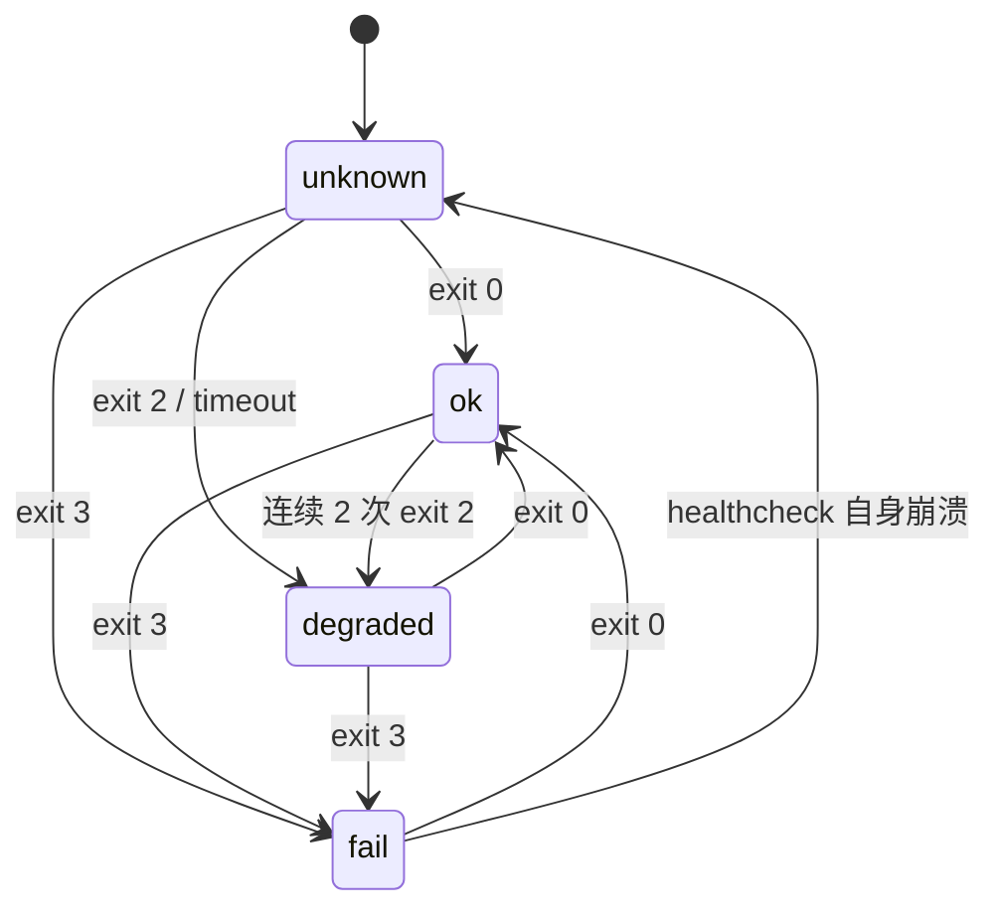

# 服务（service）：可托管的执行体

> 日期 2026-11-05。状态：**提案（设计，未实现）**。
> 关联：[`cli.md`](cli.md)（名词与动词矩阵）· [`persona-install.md`](persona-install.md) · [`kit-install.md`](kit-install.md) · `packages/job`（生命周期）

## 0. 一句话

**persona 决定「你是谁」，kit 决定「你会什么」，service 决定「你在后台干什么、活没活着」。**

## 1. 缺口

现有名词只覆盖前两件事：

| 名词 | 管什么 | 不管什么 |
|---|---|---|
| `persona` | 可被选中的 agent 定义（entry / hosts / capabilities / kits） | 后台常驻、调度、健康 |
| `kit` | 知识 / 技能 / PATH 命令 / 配置，**无执行权**（`kit add` 不执行脚本） | 进程、定时、日志 |
| `job` | 调度与生命周期（launchd / cron / systemd / schtasks） | 「这个东西是什么」「入口在哪」「算不算健康」 |

后果：**每个服务仓自己写一遍契约**（README 写 install 命令、自己定义「什么算健康」、自己写卸载脚本），
彼此不一致；「进程活着但三天没干活」没有任何一层能发现。

## 2. 构成

```
service = entry（脚本入口 | persona 会话）
        + lifecycle（job：periodic / bounded / service）
        + contract（stdin / 退出码 / 幂等键 / 日志）
        + healthcheck（可选）
        + 可选 kits（内容依赖）
```

- **是**一个可被托管的执行体
- **不是** kit（无执行权）、**也不是** persona（不需要「人格/会话」的脚本型服务占多数）

## 3. 清单（`dia.json`，`kind=service`）

```jsonc
{
  "schema": 1,
  "kind": "service",
  "id": "example-worker",
  "version": "0.1.0",
  "entry": { "cmd": "bin/example-worker" },          // 稳定入口；禁止 checkout 绝对路径
  "lifecycle": { "type": "periodic", "interval": 300, "target": "local" },
  "contract": { "stdin": "json", "exit": "0=ok/2=retry", "idempotent_by": "event_id" },
  "healthcheck": { "cmd": "bin/healthcheck --json", "interval": 1800, "timeout": 60,
                   "ok_exit": [0], "degraded_exit": [2] },
  "kits": [],
  "requires": { "dia": ">=0.1.0" }
}
```

| 字段 | 语义 |
|---|---|
| `entry.cmd` | **稳定入口**（仓内 `bin/*`，由安装步骤解析；不得写 checkout 绝对路径） |
| `lifecycle.type` | `periodic` / `bounded` / `service`（直接映射 `dia job install --type`） |
| `lifecycle.target` | `local` / 主机名（多机部署时的归属声明，供 `status` 提示） |
| `contract` | 与调用方/事件源的约定（stdin 格式、退出码语义、幂等键）**只声明，不执行** |
| `healthcheck` | 见 §4；缺省表示「只报生命周期状态」 |

## 4. healthcheck 契约（本提案的核心）

> 目的：区分「**进程在**」与「**在干活**」。前者 `job` 已经能答，后者只能由服务自己答。

| 项 | 约定 |
|---|---|
| 判据来源 | **服务自己给**：进程退出码 `0 = ok`、`2 = degraded`、`3 = fail`（其它非 0 → fail） |
| 结构化输出 | 可选 stdout JSON：`{ "status": "ok|degraded|fail", "checks": [{ "name", "level", "detail" }] }` |
| 超时 | `healthcheck.timeout`（默认 60s）；超时记 **degraded**，不杀服务 |
| 自身崩溃 | 记 **unknown**（不谎报 fail，也不冒充 ok） |
| 调度 | `healthcheck.interval`（默认 1800s），由 dia 侧托管（复用 `job`，不新增调度器） |
| 结果去向 | 最近一次结果 + 时间**并入 `dia job status`**（一列 health），历史落台账 |
| 告警 | 只负责「让状态可见」；要不要通知由使用者/上层策略决定（不在本提案内定渠道） |



**反例（明确不做）**：
- ❌ 用「进程 pid 存在」当健康判据（服务空转时 pid 也活着）
- ❌ 把 `degraded`（落后/正在重试）当成 `fail`（会产生噪声告警）
- ❌ dia 自己推断业务健康（它不知道业务语义）

## 5. CLI 面（与 persona/kit 动词矩阵对齐）

```
dia service add|remove|list|show|verify
dia service health <id>        # 立即跑一次（只读，不改生命周期）
```

| 动作 | 行为 |
|---|---|
| `add` | 取回 → 校验 entry（存在/可执行/在仓内）→ 转发 `dia job install` → 写 lock |
| `remove` | 反向：`dia job uninstall` + 回收受管产物（对称） |
| `verify` | entry 存在/可执行 + lock hash + job registry 一致（`E_DRIFT`） |
| `health` | 跑 `healthcheck.cmd`，输出三态（不写状态） |

## 6. 与 `job` 的关系

- `job` 仍是**唯一调度实现**（不新增第二套）
- `service` 只多一层「声明 + 校验 + 健康检查」
- `dia job status` 的每行增加 `health=<ok|degraded|fail|unknown> (Ns ago)`

## 7. 边界与异常

| 场景 | 行为 |
|---|---|
| `entry` 是绝对路径 / 在仓外 | `E_UNSTABLE_ENTRY`（历史教训：清理 worktree 后 127/78 静默死亡） |
| 无 `healthcheck` | 允许；`status` 只显示生命周期，不伪造健康 |
| `healthcheck` 超时 | degraded + 记 timeout |
| `healthcheck` 崩溃/输出不可解析 | unknown |
| 平台无 job 后端 | `E_BACKEND`（明确不支持，不静默装半套） |
| 多机同服务 | `lifecycle.target` 声明归属；单写者由服务自己保证（dia 只提示） |

## 8. 迁移与兼容

- 现存「只有 README 契约」的服务 → 视为 **adopted**：`list/show` 可见，`verify/health` 需先补 `dia.json`
- 不改变 `persona` / `kit` 语义；`kit` 仍无执行权
- 与「数据根（`~/.dia`）」迁移解耦：`service` 不引入新的根，只引用 `entry` 与 `lifecycle`

## 9. 开放问题

1. **agent 型服务**（entry 是 persona 会话）是否本版支持？建议：先只做脚本型，agent 型留 P2。
2. healthcheck 结果落点：并入 job 台账（`state.jsonl`）还是独立 `health.jsonl`？
3. 是否允许一个服务声明**多个 healthcheck**（例如依赖检查 + 业务推进检查）？建议：单一 `cmd` 自己聚合。
4. 与 `notify` 的关系：只暴露状态 vs 内建告警阈值。（本提案选前者，保持职责单一。）

## 10. 验收标准

- [ ] 单测：清单校验（字段/类型/entry 规则）、退出码映射、超时、unknown 三态
- [ ] e2e：装一个 demo 服务 → health 的 ok / degraded / fail 三态都能复现
- [ ] 兼容：无 `healthcheck` 的 service 不报错；未迁移的 adopted 服务只读可见
- [ ] `dia job status` 能看到 health 列且不阻塞（healthcheck 慢不拖累 status）
